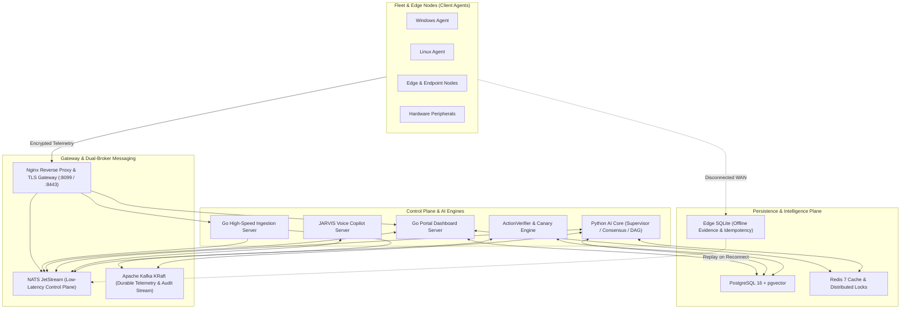

# 🌐 AI-NOC-ITSM — Operator-Controlled Autonomous Intelligence (OCAI) Platform

> **Sovereign AIOps Platform, Controlled Self-Healing Infrastructure, Cross-Layer OSI (L1–L7) Observability, and JARVIS Full-Duplex Voice Copilot.**

[](docs/02_ARCHITECTURE/)
[](.agents/AGENTS.md)
[](SERVER/python_ai_core/tests/)
[](docker-compose.yml)

---

## 📌 Ringkasan Eksekutif (Executive Summary)

**AI-NOC-ITSM** adalah sistem manajemen operasional insiden teknologi informasi (*ITSM/NOC*) terdistribusi tingkat enterprise. Dirancang untuk mendeteksi, mendiagnosis, mengisolasi akar masalah (*Root Cause Analysis / RCA*), dan memulihkan insiden operasional secara terkendali (*controlled self-healing*) pada armada perangkat Linux & Windows, edge nodes, hingga kluster server pusat.

Platform ini beroperasi di bawah model tata kelola kewenangan **Operator-Controlled Autonomous Intelligence (OCAI)**, mengintegrasikan **JARVIS Voice Assistant**, **5 Pilar Sovereign AIOps**, observabilitas lintas lapisan jaringan **OSI Layer 1 (Physical) hingga Layer 7 (Application)**, serta pengawalan verifikasi berbasis **Axiom Rule #6**.

---

## 🏛️ Model Tata Kelola: Operator-Controlled Autonomous Intelligence (OCAI)

OCAI adalah **model tata kelola kecerdasan dan batas kewenangan sistem** yang menempatkan otoritas tertinggi di tangan operator manusia (*Bounded Autonomy*, bukan otonomi tanpa batas):

1. **Intelligence Freedom**: AI memiliki kebebasan kognitif untuk melakukan *reasoning*, analisis, korelasi kausal dua arah, simulasi *digital twin*, prediksi, dan perencanaan.
2. **Bounded Autonomy**: AI hanya boleh bertindak dalam batas kewenangan eksplisit (*Authority Envelope*) yang ditetapkan operator beserta pembatasan *blast radius*.
3. **Operator Sovereignty**: Operator memiliki otoritas tertinggi atas kebijakan, veto instan, tombol darurat (*kill-switch*), dan hak persetujuan (*Human-in-the-Loop / HITL*).
4. **Policy Enforcement**: *Governance Engine* memvalidasi setiap tindakan sebelum eksekusi (*Fail-Closed by Default* dengan otorisasi kriptografis berbatas waktu).
5. **Verified Execution (Axiom Rule #6)**: AI dilarang berasumsi berhasil hanya karena perintah telah dikirim. Resolusi sah hanya jika bukti ganda (*Execution ACK* + *Live Post-Telemetry Metrics* dengan timestamp `T_post ≥ T_exec`) terpenuhi.
6. **Controlled Self-Evolution**: AI diizinkan menyempurnakan strategi taktis via *Reinforcement Learning from Incident Feedback (RLIF)*, namun **dilarang memperluas kewenangannya sendiri** atau memodifikasi kode sumbernya sendiri (seluruh *volume mount* kode AI dikunci `:ro` / *read-only*).

---

## 🏛️ Arsitektur Sistem End-to-End & Dual-Broker Messaging

Sistem menggunakan arsitektur **Dual-Broker** dengan pemisahan tanggung jawab yang tegas:
- **NATS & JetStream (Low-Latency Control Plane):** Menangani *command/RPC* sub-milidetik ke agen endpoint, *heartbeat*, pembatalan interupsi suara (*barge-in*), dan sinyal kontrol *real-time*.
- **Apache Kafka KRaft (Durable High-Throughput Data & Audit Plane):** Menangani *streaming* telemetri volume tinggi, penyimpanan *event log* jangka panjang, dan jejak audit kepatuhan (*immutable audit trail*).



---

## ⚡ 5 Pilar Sovereign AIOps

| No | Pilar Arsitektur | Modul Implementasi | Deskripsi & Dampak Operasional |
| :---: | :--- | :--- | :--- |
| **1** | **Multi-Variate & Seasonal Diurnal Anomaly Detection** | [`temporal_reasoning_engine.py`](SERVER/python_ai_core/cognition/temporal_reasoning_engine.py) | Mengkalibrasi ambang batas secara dinamis untuk jam kerja vs luar jam kerja (toleransi deviasi hingga ≤ 15% saat beban puncak), serta mendeteksi anomali komposit: *Silent Deadlock, Memory Thrashing (RAM > 90%), Network Blackhole (Packet Loss > 5%), dan Resource Starvation*. |
| **2** | **Downstream Blast Radius Predictive Simulator** | [`execution_orchestrator.py`](SERVER/python_ai_core/governance/execution_orchestrator.py) | Memindai graf `device_dependencies`. Jika tindakan perbaikan berisiko mengganggu host hilir atau node infrastruktur kritis, otomatis di-*downgrade* ke *Human-in-the-Loop (HITL)*. |
| **3** | **Synthetic Functional Canary Probing** | [`action_verifier.py`](SERVER/python_ai_core/verification/action_verifier.py) | Memvalidasi kebenaran fisik melampaui status proses OS (menginspeksi antrean perangkat keras dan respon data plane nyata sebelum menyatakan insiden selesai). |
| **4** | **Semantic Environment Tagging on Golden SOPs** | [`incident_learning.py`](SERVER/python_ai_core/supervisor/handlers/incident_learning.py) & [`rag_engine.py`](SERVER/python_ai_core/engines/rag_engine.py) | Menandai metadata OS (`target_os:windows`, `target_os:linux`) pada vektor pengetahuan. Algoritma RRF memberikan *boost* untuk OS yang cocok dan memblokir SOP yang bertentangan. |
| **5** | **Disconnected Edge Autonomy & Local Replay** | [`edge_anomaly_watcher.go`](CLIENT_DISTRIBUSI_GO/agent/edge_anomaly_watcher.go) & [`remediation_subscriber.go`](CLIENT_DISTRIBUSI_GO/agent/remediation_subscriber.go) | Jika WAN terputus, agen distribusi mengeksekusi *safe playbooks* mandiri, mencatat bukti ke SQLite lokal, dan me-*replay* sinkronisasi ke server saat koneksi pulih. |

---

## 🎙️ JARVIS Voice Copilot & Speech Architecture

JARVIS beroperasi dengan kapabilitas komunikasi dua arah (*Full-Duplex*):

- **Neural Text-to-Speech (TTS):** Menggunakan model suara Bahasa Indonesia dengan *Circuit Breaker Fallback* ke *TTS* lokal.
- **Speech-to-Text (STT):** Didukung Faster-Whisper dengan penyuntikan kosakata istilah teknis NOC Indonesia (BGP, OSPF, SLA, HITL, Spooler, Packet Loss).
- **Spoken Text Normalizer:** Menerjemahkan akronim teknis dan alamat jaringan ke pembacaan fonetik serta memangkas sintaks markdown.
- **Deterministic Ground-Truth Fast-Track:** Pertanyaan status operasional *real-time* dijawab langsung melalui kueri deterministik ke basis data terstruktur PostgreSQL/Redis (tanpa melalui generasi teks bebas LLM) untuk meminimalkan risiko fabrikasi data.
- **Barge-In Interruption:** Operator dapat memotong pembicaraan JARVIS kapan saja; JARVIS seketika berhenti berbicara dan mendengarkan perintah baru.

---

## 🌐 Cakupan Observabilitas Cross-Layer OSI (L1–L7) & 18 Playbook Terdaftar

AI NOC memetakan kesehatan infrastruktur secara vertikal dari Layer 1 hingga Layer 7 melalui **18 Playbook Produksi** yang tersimpan di [`seed_production_playbooks.sql`](SERVER/database/seed_production_playbooks.sql) serta 22 SOP terstruktur pada Matrix Pengetahuan [`osi_layer_matrix.py`](SERVER/python_ai_core/knowledge/osi_layer_matrix.py), dilengkapi pengaman *Human-in-the-Loop (HITL)* dan *Auto-Rollback* untuk aksi berisiko tinggi:

| Lapisan OSI | Domain yang Dipantau | Playbook Terdaftar di Database (`ai_playbooks`) | Mode Pengaman & Verifikasi |
| :--- | :--- | :--- | :--- |
| **Layer 1 (Physical)** | Kapasitas Disk, Status Link NIC, Periferal Fisik | 1. `L1 - Disk Cleanup & Log Rotation`<br>2. `L1 - Network Interface Link Reset`<br>3. `Clear Temp Files` | Playbook #2 dikunci dengan **HITL Approval & Local Link Auto-Rollback Timer** agar tidak memutus akses agen permanen. |
| **Layer 2 (Data Link)** | ARP Cache Inconsistency, Virtual Bridge Loop | 4. `L2 - Flush ARP Cache & Neighbor Table`<br>5. `L2 - Reset Virtual Bridge Interface` | Playbook #5 wajib melalui **HITL Gate** jika menopang antarmuka manajemen utama. |
| **Layer 3 (Network)** | BGP/OSPF Route Flap, Gateway Reachability, Firewall State | 6. `L3 - Route Table & Gateway Failover Reset`<br>7. `L3 - Firewall Table Remediation` | Playbook #6 & #7 menggunakan **Transactional Rollback** jika koneksi ke gateway gagal pulih dalam 15 detik. |
| **Layer 4 (Transport)** | TCP TIME_WAIT Accumulation, Ephemeral Port Exhaustion | 8. `L4 - TCP TIME_WAIT Socket Recycling`<br>9. `L4 - Port Exhaustion Mitigation` | Bounded Autonomy (Safe Kernel Sysctl Bounds). |
| **Layer 5 (Session)** | Session Cache Inconsistency, Message Broker Sync | 10. `L5 - Redis Cache & Session Storage Flush`<br>11. `L5 - NATS Message Streaming Broker Auto-Heal` | Playbook #10 hanya menghapus *expired session prefix* (bukan `FLUSHALL` buta) dan memerlukan **HITL** pada kluster produksi. |
| **Layer 6 (Presentation)** | Handshake TLS/SSL, Buffer Kompresi & Encoding | 12. `L6 - TLS Certificate & Nginx Reverse Proxy Reload`<br>13. `L6 - Compression & Encoding Buffer Purge` | Validasi konfigurasi (`nginx -t`) wajib lolos sebelum reload. |
| **Layer 7 (Application)** | Deadlock DB, Telemetry Stream Buffer, Orkestrasi Workflow | 14. `L7 - PostgreSQL Deadlock & Idle Connection Kill`<br>15. `L7 - Python AI Core Engine Auto-Heal`<br>16. `L7 - Ingestion Server Telemetry Buffer Reset`<br>17. `L7 - n8n Workflow Automation Engine Auto-Restart`<br>18. `Restart PostgreSQL` | Diverifikasi dengan *Synthetic Canary Probing* dan *Dual-Evidence Binding* (`T_post ≥ T_exec`). |

---

## 🛡️ Prinsip Tata Kelola & Keamanan (*Governance Guardrails*)

### 1. The Fundamental Remediation Governance Axiom (Rule #6)
> *"AI boleh menghasilkan, menjelaskan, dan mengarahkan remediation manual; AI tidak boleh menganggap remediation manual berhasil hanya karena command/SOP tersedia. Keberhasilan hanya sah setelah execution evidence dan post-remediation evidence terhubung ke incident yang sama."*

- Tiket terkunci pada status `PENDING_VERIFICATION` hingga bukti eksekusi + bukti live telemetri pasca-remediasi (`T_post ≥ T_exec`) tervalidasi.

### 2. Aturan Keamanan Suara K-07
- Perintah berisiko tinggi (*approve shutdown*, *delete database*, *force override*) **TIDAK DAPAT disahkan hanya melalui suara**. JARVIS akan menolak dan mengarahkan operator untuk melakukan konfirmasi bertanda tangan di Dashboard Web.

### 3. Kill-Switch Darurat & Autonomy Budget
- Perintah darurat *Kill-Switch* seketika membekukan seluruh aksi otonom AI.
- Autonomy Budget membatasi frekuensi percobaan perbaikan otomatis pada perangkat yang sama guna mencegah *infinite reboot loop*.

---

## 🚀 Panduan Memulai (Quickstart)

### Spesifikasi Sistem & Prasyarat
- **RAM Minimum:** **16 GB RAM** (direkomendasikan 32 GB RAM untuk menjalankan seluruh 15+ kontainer beserta Apache Kafka, PostgreSQL pgvector, dan model STT/Embeddings secara bersamaan).
- **Perangkat Lunak:** Docker 24.0+ & Docker Compose v2.20+, Go 1.26+, Python 3.11+, GNU Make.
- **Layanan Opsional Eksternal:** Integrasi workflow webhook `n8n` (`N8N_URL`) dan `Netdata` bersifat opsional dan dapat dihubungkan melalui variabel lingkungan di `.env`.

### Langkah Kompilasi & Menjalankan Layanan
> **Catatan Keamanan:** Jangan pernah menyimpan kredensial produksi, API key, atau sertifikat privat di dalam repositori publik. Jalankan `make setup` untuk menginisialisasi `.env`, `portal/ai_config.json`, dan `docker/nginx/.htpasswd` dari template contoh (semuanya diabaikan oleh Git). Isi seluruh variabel wajib (`DB_PASSWORD`, `REDIS_PASSWORD`, `NATS_TOKEN`, `OSI_SECURITY_KEY`, `PGADMIN_PASSWORD`, `KAFKA_UI_PASSWORD`) sebelum menyalakan kontainer.

```bash
# 1. Inisialisasi file environment dan konfigurasi dari template contoh
make setup

# 2. Isi seluruh variabel rahasia wajib di file .env

# 3. Kompilasi binary server Go (ingestion_server, portal, secure_relay) ke ./build/bin/
make build

# 4. (Opsional) Kompilasi binary agen endpoint untuk Windows & Linux
make build-agents

# 5. Jalankan seluruh stack layanan Docker
docker compose up -d
```

### Akses Layanan Default
- **NOC Gateway (Nginx HTTP):** `http://localhost:8099` (dikonfigurasi melalui `PROXY_HTTP_PORT`, default `8099`)
- **NOC Gateway (Nginx HTTPS):** `https://localhost:8443` (dikonfigurasi melalui `PROXY_HTTPS_PORT`, default `8443`)
- **Portal Dashboard Langsung:** `http://127.0.0.1:8090`
- **Portainer CE:** `http://127.0.0.1:9000` (diikat ke `127.0.0.1` secara default melalui `PORTAINER_BIND_IP` dengan socket Docker `:ro`)

---

## 📁 Struktur Direktori Utama

```text
AI-NOC-ITSM/
├── CLIENT_DISTRIBUSI_GO/      # Kode sumber Agen Distribusi (Windows & Linux)
├── SERVER/                    # Backend Core & Mesin AI
│   ├── jarvis/                # Sub-sistem JARVIS Voice, Persona & Intent Router
│   ├── python_ai_core/        # AI Supervisor, Temporal Engine, RAG 2.0, Verifier
│   └── go_core/               # Ingestion Server berkecepatan tinggi
├── portal/                    # Go Portal Dashboard Server & Secure Relay
├── docker/                    # Konfigurasi kontainer infrastruktur (Nginx, NATS, Postgres)
├── Makefile                   # Orkestrasi build binary server, agen, dan pengujian
├── docker-compose.yml         # Orkestrasi multi-kontainer Docker
└── LICENSE                    # Lisensi perangkat lunak enterprise
```

---

## 📄 Lisensi
Hak Cipta © 2026 Tim Pengembang Advanced Agentic AI. Lihat file [`LICENSE`](LICENSE) untuk ketentuan lengkap penggunaan dan distribusi.
