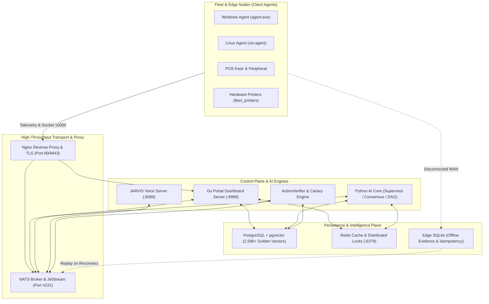

# 🌐 OSI AI Incident Analysis & Sovereign AIOps Platform

> **Level 5 Autonomous Sovereign AIOps, Self-Healing Infrastructure, Cross-Layer OSI (L1–L7) Observability, and JARVIS Full-Duplex Voice Copilot.**

[](file:///home/it-itsm/AI/incident-analysis/docs/)
[](file:///home/it-itsm/AI/incident-analysis/.agents/AGENTS.md)
[-brightgreen?style=for-the-badge)](file:///home/it-itsm/AI/incident-analysis/tests/)
[](file:///home/it-itsm/AI/incident-analysis/docker-compose.yml)

---

## 📌 Ringkasan Eksekutif (Executive Summary)

**OSI AI Incident Analysis Platform** adalah sistem manajemen operasional insiden teknologi informasi (*ITSM/NOC*) otonom terdistribusi tingkat enterprise. Dirancang untuk mendeteksi, mendiagnosis, mengisolasi akar masalah (*Root Cause Analysis / RCA*), dan memulihkan insiden operasional secara mandiri (*self-healing*) pada armada perangkat Linux & Windows, edge nodes toko/kasir, hingga kluster server pusat.

Platform ini mengintegrasikan **JARVIS Voice Assistant**, **5 Pilar Sovereign AIOps**, observabilitas lintas lapisan jaringan **OSI Layer 1 (Physical) hingga Layer 7 (Application)**, serta pengawalan tata kelola ketat berbasis **Axiom Rule #6**.

---

## 🏛️ Arsitektur Sistem End-to-End



---

## ⚡ 5 Pilar Sovereign AIOps (Level 5 Autonomy)

Sistem telah disempurnakan dengan 5 pilar arsitektur kedaulatan AIOps tertinggi:

| No | Pilar Arsitektur | Modul Implementasi | Deskripsi & Dampak Operasional |
| :---: | :--- | :--- | :--- |
| **1** | **Multi-Variate & Seasonal Diurnal Anomaly Detection** | [`temporal_reasoning_engine.py`](file:///home/it-itsm/AI/incident-analysis/SERVER/python_ai_core/cognition/temporal_reasoning_engine.py) | Mengkalibrasi ambang batas secara dinamis untuk jam kerja sibuk ($1.08\times$) vs malam hari ($0.82\times$), serta mendeteksi anomali komposit: *Silent Deadlock, Memory Thrashing, Network Blackhole, dan Resource Starvation*. |
| **2** | **Downstream Blast Radius Predictive Simulator** | [`execution_orchestrator.py`](file:///home/it-itsm/AI/incident-analysis/SERVER/python_ai_core/governance/execution_orchestrator.py) | Memindai graf `device_dependencies`. Jika tindakan perbaikan berisiko mengganggu $\ge 3$ host hilir atau node infrastruktur kritis (POS/DB) saat jam sibuk, otomatis di-*downgrade* ke *Human-in-the-Loop (HITL)*. |
| **3** | **Synthetic Functional Canary Probing** | [`action_verifier.py`](file:///home/it-itsm/AI/incident-analysis/SERVER/python_ai_core/verification/action_verifier.py) | Memvalidasi kebenaran fisik melampaui status proses OS (mis. menginspeksi antrean printer hardware dan respon data plane ICMP/HTTP nyata sebelum menyatakan insiden selesai). |
| **4** | **Semantic Environment Tagging on Golden SOPs** | [`incident_learning.py`](file:///home/it-itsm/AI/incident-analysis/SERVER/python_ai_core/supervisor/handlers/incident_learning.py) & [`rag_engine.py`](file:///home/it-itsm/AI/incident-analysis/SERVER/python_ai_core/engines/rag_engine.py) | Menandai metadata OS (`target_os:windows`, `target_os:linux`) pada vektor pengetahuan. Algoritma RRF memberikan *boost* $1.25\times$ untuk OS yang cocok dan memblokir SOP yang bertentangan. |
| **5** | **Disconnected Edge Autonomy & Local Replay** | [`edge_anomaly_watcher.go`](file:///home/it-itsm/AI/incident-analysis/CLIENT_DISTRIBUSI_GO/agent/edge_anomaly_watcher.go) & [`remediation_subscriber.go`](file:///home/it-itsm/AI/incident-analysis/CLIENT_DISTRIBUSI_GO/agent/remediation_subscriber.go) | Jika WAN terputus $> 3\text{ menit}$, agen distribusi mengeksekusi *safe playbooks* mandiri, mencatat bukti ke SQLite lokal, dan me-*replay* sinkronisasi ke server saat koneksi pulih. |

---

## 🎙️ JARVIS Voice Copilot & Speech Architecture

JARVIS beroperasi pada kontainer `osi-jarvis-voice-server` (Port 8089) dengan kapabilitas komunikasi dua arah (*Full-Duplex*):

- **Neural Text-to-Speech (TTS):** Menggunakan model suara AI Bahasa Indonesia natural (`id-ID-GadisNeural` / `id-ID-ArdiNeural` via EdgeTTS) dengan *Circuit Breaker Fallback* 60ms ke *KokoroTTS* lokal.
- **Speech-to-Text (STT):** Didukung Faster-Whisper dengan penyuntikan 60+ istilah teknis NOC Indonesia (BGP, OSPF, SLA, HITL, Spooler, Kasir, Packet Loss).
- **Spoken Text Normalizer:** Menerjemahkan akronim teknis (`CPU` $\rightarrow$ *"C-P-U"*, `192.168.1.1` $\rightarrow$ pembacaan fonetik) dan memangkas sintaks markdown.
- **Zero-LLM Fast-Track (< 50ms):** Pertanyaan status real-time langsung dijawab dari basis data fakta (*Ground Truth*) tanpa halusinasi.
- **Barge-In Interruption:** Operator dapat memotong pembicaraan JARVIS kapan saja; JARVIS seketika berhenti berbicara dan mendengarkan perintah baru.

---

## 🌐 Cakupan Observabilitas Cross-Layer OSI (L1–L7)

AI NOC memetakan kesehatan infrastruktur secara vertikal dengan 18 Playbook Terintegrasi:

| Lapisan OSI | Domain yang Dipantau | Playbook Remediasi Otomatis Terpasang |
| :--- | :--- | :--- |
| **Layer 1 (Physical)** | Disk Root/Var $>90\%$, NIC Link Down, Kertas Macet | `L1 - Disk Cleanup & Log Rotation`, `L1 - Network Interface Link Reset` |
| **Layer 2 (Data Link)** | Wi-Fi RSSI $< -80\text{ dBm}$, ARP Cache, Virtual Bridge | `L2 - Flush ARP Cache & Neighbor Table`, `L2 - Reset Virtual Bridge` |
| **Layer 3 (Network)** | BGP/OSPF Route Flap, Gateway Down, Loss $>5\%$ | `L3 - Route Table & Gateway Failover Reset`, `L3 - Firewall Remediation` |
| **Layer 4 (Transport)** | TCP TIME_WAIT Accumulation, Ephemeral Port Exhaustion | `L4 - TCP TIME_WAIT Socket Recycling`, `L4 - Port Exhaustion Mitigation` |
| **Layer 5 (Session)** | NATS Cluster Sync, Redis State Stalling | `L5 - Redis Storage Flush`, `L5 - NATS Message Streaming Broker Auto-Heal` |
| **Layer 6 (Presentation)** | SSL/TLS Handshake Error, Nginx Proxy Reload | `L6 - TLS Certificate & Proxy Reload`, `L6 - Compression Buffer Purge` |
| **Layer 7 (Application)** | Print Spooler (`spoolsv`), Postgres Deadlock, n8n | `L7 - Postgres Deadlock Kill`, `L7 - Python AI Auto-Heal`, `L7 - n8n Restart` |

---

## 🛡️ Prinsip Tata Kelola & Keamanan (*Governance Guardrails*)

### 1. The Fundamental Remediation Governance Axiom (Rule #6)
> *"AI boleh menghasilkan, menjelaskan, dan mengarahkan remediation manual; AI tidak boleh menganggap remediation manual berhasil hanya karena command/SOP tersedia. Keberhasilan hanya sah setelah execution evidence dan post-remediation evidence terhubung ke incident yang sama."*

- Tiket terkunci pada status `PENDING_VERIFICATION` hingga bukti eksekusi + bukti live telemetri pasca-remediasi ($T_{\text{post}} \ge T_{\text{exec}}$) tervalidasi.

### 2. Aturan Keamanan Suara K-07
- Perintah berisiko tinggi (*approve shutdown*, *delete database*, *force override*) **TIDAK DAPAT disahkan hanya melalui suara**. JARVIS akan menolak dan mengarahkan operator untuk melakukan konfirmasi bertanda tangan di Dashboard Web.

### 3. Kill-Switch Darurat & Autonomy Budget (GATE-07)
- Perintah suara *"Jarvis, aktifkan Kill-Switch"* seketika membekukan seluruh aksi otonom AI.
- Autonomy Budget membatasi maksimal 2 kali percobaan perbaikan per jam untuk perangkat yang sama guna mencegah *infinite reboot loop*.

---

## 🚀 Panduan Memulai & Operasional (Runbook)

### Prasyarat
- Docker 24.0+ & Docker Compose v2.20+
- Go 1.22+ (untuk build agen & portal)
- Python 3.11+
- RAM Minimum: 8 GB (Rekomendasi: 16 GB untuk AI Models)

### 1. Menjalankan Layanan (Docker Compose)
```bash
# Clone repository
git clone https://github.com/ramadhan24021996/AI-NOC-ITSM.git
cd AI-NOC-ITSM

# Menjalankan seluruh stack layanan
docker compose up -d
```

### 2. URL Akses Layanan & Port Dashboard
- **Web Portal Dashboard:** [http://localhost:80](http://localhost) atau [https://localhost:9443](https://localhost:9443)
- **Portainer (Docker Manager):** [http://localhost:9000](http://localhost:9000) atau [https://localhost:9444](https://localhost:9444)
- **pgAdmin (PostgreSQL UI):** [http://localhost:5050](http://localhost:5050)
- **Kafka UI:** [http://localhost:8090](http://localhost:8090)
- **Netdata Master:** [http://localhost:19999](http://localhost:19999)
- **n8n Workflow Engine:** [http://localhost:5678](http://localhost:5678)
- **JARVIS Voice Health:** `http://localhost:8089/jarvis/health`

### 3. Kompilasi Binary Agen & Portal
```bash
# Kompilasi Go Portal Dashboard Server (Static Alpine Linux)
CGO_ENABLED=0 GOOS=linux GOARCH=amd64 go build -o ./build/bin/portal ./portal

# Kompilasi Agen Distribusi Windows
GOOS=windows GOARCH=amd64 go build -o CLIENT_DISTRIBUSI_GO/agent/agent.exe ./CLIENT_DISTRIBUSI_GO/agent

# Kompilasi Agen Distribusi Linux
CGO_ENABLED=0 GOOS=linux GOARCH=amd64 go build -o CLIENT_DISTRIBUSI_GO/linux_agent/osi-agent ./CLIENT_DISTRIBUSI_GO/linux_agent
```

### 4. Menjalankan Test Suite Governance
```bash
PYTHONPATH=SERVER/python_ai_core:. pytest -v tests/test_ai_incident_analysis_governance.py tests/test_jarvis_voice_governance.py
```
*Status: 20/20 Test Cases Passed (100%).*

---

## 📁 Struktur Direktori Utama

```
incident-analysis/
├── CLIENT_DISTRIBUSI_GO/      # Kode sumber Agen Distribusi (Windows & Linux)
│   ├── agent/                 # Windows Agent (Idempotency, WMI, Spooler Watcher)
│   └── linux_agent/           # Linux Agent (Systemd, SysFS, TCP Port 10000)
├── SERVER/                    # Backend Core & Mesin AI
│   ├── jarvis/                # Sub-sistem JARVIS Voice, Persona & Intent Router
│   │   ├── api/               # Threaded HTTP & WebSocket Voice Server
│   │   ├── command/           # Kamus 450+ Kata Kunci NOC Bahasa Indonesia
│   │   └── voice/             # FasterWhisper STT, EdgeTTS, Spoken Normalizer
│   ├── python_ai_core/        # AI Supervisor, Temporal Engine, RAG 2.0, Verifier
│   └── go_core/               # Ingestion Server berkecepatan tinggi
├── portal/                    # Go Portal Dashboard Server (Gin Framework)
│   ├── dashboard/             # REST API Handlers, Incident Manager, HITL Outbox
│   └── static/                # Frontend Assets, Voice Duplex Client, Canvas UI
├── docker/                    # Konfigurasi Nginx HA, Sertifikat TLS, Postgres Init
├── docker-compose.yml         # Orkestrasi multi-kontainer Docker
└── tests/                     # Suite Pengujian Kepatuhan Governance & Voice
```

---

## 📄 Lisensi
Hak Cipta © 2026 Tim Pengembang Advanced Agentic AI. Dilindungi oleh kebijakan tata kelola sistem enterprise AI.
