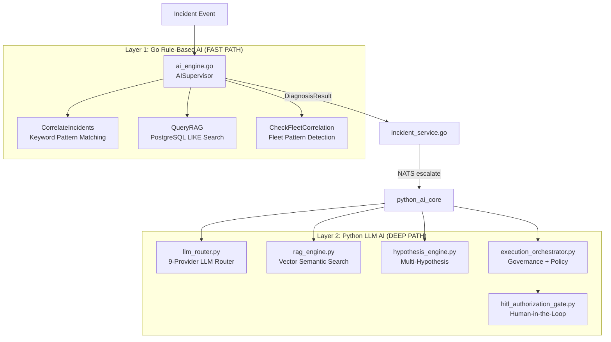

# AI SYSTEM AUDIT
## OSI NOC IT AI — AI/LLM/Agent Forensic Audit
**Evidence:** SERVER/go_core/ai/ai_engine.go, SERVER/python_ai_core/llm_router.py,  
SERVER/python_ai_core/engines/rag_engine.py, SERVER/python_ai_core/core/workflow_orchestrator.py  
**Status:** MULTI-LAYER AI SYSTEM — Go rule-based + Python LLM-based

---

## AI SYSTEM OVERVIEW

The system has TWO distinct AI layers:



---

## LAYER 1: GO AI ENGINE (ai_engine.go)

### Status: VERIFIED — RULE-BASED, NO LLM CALL

| Component | Implementation | Status |
|-----------|----------------|--------|
| CorrelateIncidents() | Keyword pattern matching (gateway/router/agent/database) | VERIFIED |
| QueryRAG() | PostgreSQL LIKE text search on knowledge_vectors | VERIFIED (text only, no semantic) |
| CheckFleetCorrelation() | SQL query fleet_incidents last 24h, count by device/site | VERIFIED |
| DiagnoseIncident() | Rule-based switch/case on predCode | VERIFIED |
| RetrainClassifier() | Returns MOCKED metrics with 100ms sleep | MOCK |
| PredictIncident() | Count-based threshold on incidents last 24h | VERIFIED |

### AI Models Used: NONE (Go layer uses no LLM)

### RCA Algorithm (Go — VERIFIED):
```
1. Parse alerts (question + evidence strings)
2. Check keywords → predCode:
   - "gateway"/"router"/"ping" → NETWORK_GATEWAY_DOWN
   - "database"/"postgres"/"connection pool" → DATABASE_POOL_EXHAUSTED
   - "agent"/"pc_client"/"offline" → CLIENT_SERVICE_STOPPED
   - default → UNKNOWN_ANOMALY
3. Map predCode → fixed DiagnosisResult (hardcoded cause/action/recommendation)
4. QueryRAG() text search → HistoricalSimilarity
5. CheckFleetCorrelation() → FleetPattern
6. Calculate confidence score: telemetry(30%) + historical(30%) + dependency(20%) + temporal(20%) + severity_bonus
7. Apply penalties: VECTOR_UNAVAILABLE(-25%), DEPENDENCY_INCOMPLETE(-15%), TEMPORAL_INCOMPLETE(-10%)
8. Apply Tier classification (Tier 1-4)
9. Escalation decision based on: failedCount > 2, recurrenceCount > 3, severityWeight > 0.85, blast radius
```

---

## LAYER 2: PYTHON LLM ROUTER (llm_router.py)

### Status: VERIFIED — 9 Provider Multi-Key Rotation Pool

| Provider | URL | Auth | Status |
|----------|-----|------|--------|
| Google Gemini | google.genai SDK | GEMINI_API_KEY (multi-key pool) | VERIFIED |
| OpenAI | https://api.openai.com/v1/chat/completions | OPENAI_API_KEY | VERIFIED |
| Groq | https://api.groq.com/openai/v1/chat/completions | GROQ_API_KEY | CONFIG_DEPENDENT |
| DeepSeek | https://api.deepseek.com/v1/chat/completions | DEEPSEEK_API_KEY | CONFIG_DEPENDENT |
| OpenRouter | https://openrouter.ai/api/v1/chat/completions | OPENROUTER_API_KEY | CONFIG_DEPENDENT |
| Mistral | https://api.mistral.ai/v1/chat/completions | MISTRAL_API_KEY | CONFIG_DEPENDENT |
| Together.ai | https://api.together.xyz/v1/chat/completions | TOGETHER_API_KEY | CONFIG_DEPENDENT |
| HuggingFace | https://api-inference.huggingface.co/v1/chat/completions | HF_API_KEY | CONFIG_DEPENDENT |
| Anthropic | Dedicated Anthropic API | ANTHROPIC_API_KEY | CONFIG_DEPENDENT |
| Ollama | http://localhost:11434/v1/chat/completions | None | CONFIG_DEPENDENT |

### LLM Key Features
- **Multi-key rotation pool**: Comma-separated keys in env, round-robin on 429
- **Fernet encryption**: API keys can be encrypted with OSI_SECURITY_KEY
- **Token circuit breaker**: MAX_TOKENS_PER_INCIDENT = 50,000 tokens
- **Provider fallback**: If primary fails, falls to next in priority order
- **Async/sync**: Both asyncio and sync call modes

### Active LLM Keys in .env
```
GEMINI_API_KEY=AQ.Ab8RN6K...  (3 comma-separated keys)
OPENAI_API_KEY=sk-proj-UTb5B32_...  (1 key)
```
**SECURITY RISK:** Both keys exposed in plaintext .env file

---

## PYTHON AI COMPONENTS

### RAG Engine (engines/rag_engine.py — 37,120 bytes)
**Status:** VERIFIED implementation, PARTIALLY_IMPLEMENTED integration

| Feature | Implementation | Status |
|---------|----------------|--------|
| Vector similarity search | pgvector cosine ops on knowledge_vectors | VERIFIED |
| Full-text search | PostgreSQL FTS + GIN index | VERIFIED |
| Hybrid scoring | Vector + FTS combined ranking | VERIFIED |
| Reranker | engines/reranker.py | VERIFIED |
| Knowledge fabric | knowledge/knowledge_fabric.py | VERIFIED |
| RAG pipeline | knowledge/world_model.py | PARTIALLY_IMPLEMENTED |

### Hypothesis Engine (cognition/hypothesis_engine.py — 16,197 bytes)
**Status:** PARTIALLY_IMPLEMENTED

- Multi-hypothesis generation
- Hypothesis ranking by evidence support
- Integration with causal DAG

### Causal DAG Engine (engines/causal_dag_engine.py — 10,830 bytes)
**Status:** PARTIALLY_IMPLEMENTED

- Build causal dependency graph
- Trace causal paths to root cause
- Integration with proposed_dag_changes table

### Governance Execution Orchestrator (governance/execution_orchestrator.py — 21,228 bytes)
**Status:** PARTIALLY_IMPLEMENTED

| Feature | Implementation | Status |
|---------|----------------|--------|
| Policy matrix (NOTIFY/TICKET/RESTART/DB_MIGRATION) | Hardcoded POLICY_MATRIX dict | VERIFIED |
| HITL gate | hitl_authorization_gate.py | VERIFIED |
| Circuit breaker | CircuitBreaker(failure_threshold=3) | VERIFIED |
| Retry with backoff | retry_with_backoff(max_retries=1, initial_delay=2.0) | VERIFIED |
| NATS request-reply | nc.request("remediation.execute", ...) | CONNECTED_BUT_NOT_VERIFIED |
| State resolver | Uses incident_states as single source of truth | VERIFIED |

### HITL Authorization Gate (governance/hitl_authorization_gate.py — 9,278 bytes)
**Status:** VERIFIED — Implemented with approval flow

| Feature | Status |
|---------|--------|
| Risk assessment | VERIFIED |
| Required approver role | VERIFIED |
| Approval timeout | VERIFIED |
| Approval persistence | VERIFIED (approval_queue table) |

### Critic Engine (engines/critic_engine.py — 35,176 bytes)
**Status:** PARTIALLY_IMPLEMENTED  
- Multi-model critic evaluation
- Confidence scoring
- Contradiction detection

### Multi-Agent System (multi_agent/)
**Status:** PARTIALLY_IMPLEMENTED

| Component | File | Status |
|-----------|------|--------|
| Orchestrator | orchestrator.py | PARTIALLY_IMPLEMENTED |
| PlannerCriticConsensus | planner_critic_consensus.py | VERIFIED (used in workflow_orchestrator) |
| AgentRegistry | agent_registry.py | VERIFIED |
| AgentHealth | agent_health.py | VERIFIED |
| TaskRouter | task_router.py | VERIFIED |

---

## LLM CALL IN INCIDENT PATH

### Go incident path → DOES NOT call LLM
```
Go: incident_service.go → ai_analysis_service.go → ai_engine.go (rule-based only)
```

### Python incident path → CAN call LLM via NATS (not verified end-to-end)
```
NATS: incident.site.{id}.escalate.request
  → Python AI Core (if subscribed)
    → execution_orchestrator.py
      → WorkflowOrchestrator.process_query()
        → LLM router (Gemini/OpenAI)
```

**Status of full Python LLM incident path:** CONNECTED_BUT_NOT_VERIFIED

---

## AI GOVERNANCE

### Policy Decision Matrix (execution_orchestrator.py)
| Action | Advisory | HITL | Autonomous |
|--------|----------|------|-----------|
| NOTIFY | AUTO | AUTO | AUTO |
| TICKET | AUTO | AUTO | AUTO |
| RESTART AGENT | DENY | APPROVAL | AUTO |
| RESTART SERVICE | DENY | APPROVAL | APPROVAL |
| DB MIGRATION | DENY | APPROVAL | DENY |
| FIREWALL CHANGE | DENY | APPROVAL | DENY |

### Confidence Thresholds (from DB seed)
```sql
learning_gate_policy: confidence_threshold = 0.75
security_policy_rules: LOW_SEVERITY min_confidence = 0.40 → AUTO_EXECUTE
security_policy_rules: HIGH_SEVERITY min_confidence = 0.80 → REQUIRE_APPROVAL
opa_policy_rules: confidence >= 0.90 and risk == LOW → AUTO_EXECUTE
opa_policy_rules: risk >= HIGH and confidence < 0.85 → FORCE_HITL
opa_policy_rules: severity == CRITICAL → FORCE_HITL
```

---

## AI SYSTEM RISKS

| Risk | Severity | Evidence |
|------|----------|---------|
| Go AI is rule-based — only 4 predcodes, no LLM | HIGH | ai_engine.go CorrelateIncidents() |
| Python LLM path not verified end-to-end | HIGH | NATS subscriber not confirmed |
| GEMINI/OPENAI keys in plaintext .env | CRITICAL | .env lines 18-19 |
| RetrainClassifier returns mocked metrics | MEDIUM | ai_engine.go line 116-130 |
| No hallucination detection in Go path | MEDIUM | No verification step |
| LLM cost not bounded per incident (token circuit breaker) | MEDIUM | llm_router.py MAX_TOKENS_PER_INCIDENT |
| No AI decision audit in Go path (only Python has ai_audit_trail) | HIGH | Go incident path |

---

## AI COMPONENT STATUS MATRIX

| Component | Exists | Implemented | LLM Active | Tested | Production Ready |
|-----------|--------|-------------|-----------|--------|-----------------|
| Go Rule-based RCA | YES | YES | NO | PARTIAL | YES |
| Go RAG (text search) | YES | YES | NO | PARTIAL | YES |
| Python LLM Router | YES | YES | YES (config) | UNKNOWN | PARTIAL |
| Python RAG Engine | YES | YES | YES (embeddings) | UNKNOWN | PARTIAL |
| Python Hypothesis Engine | YES | PARTIAL | YES | UNKNOWN | NO |
| Python Causal DAG | YES | PARTIAL | YES | UNKNOWN | NO |
| HITL Gate | YES | YES | N/A | UNKNOWN | PARTIAL |
| Multi-Agent Consensus | YES | PARTIAL | YES | UNKNOWN | NO |
| LoRA Training Pipeline | YES | PLACEHOLDER | NO | NO | NO |
| Critic Engine | YES | PARTIAL | YES | UNKNOWN | NO |
