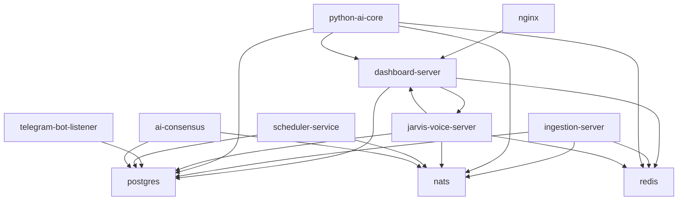

# DEPENDENCY AUDIT
## OSI NOC IT AI — Module Dependency & Coupling Analysis
**Evidence:** go.mod, Python imports, docker-compose service dependencies  
**Status:** VERIFIED dependency analysis

---

## GO DEPENDENCIES (go.mod)

| Package | Version | Usage | Risk |
|---------|---------|-------|------|
| github.com/gorilla/websocket | latest | WebSocket in portal | LOW — stable |
| github.com/nats-io/nats.go | latest | NATS + JetStream | LOW — stable |
| github.com/go-redis/redis/v8 | v8 | Redis client | LOW — stable |
| github.com/google/uuid | latest | UUID generation | LOW |
| gorm.io/gorm | latest | ORM | LOW — stable |
| gorm.io/driver/postgres | latest | GORM PostgreSQL | LOW — stable |
| github.com/golang-jwt/jwt | latest | JWT auth | LOW — stable |
| golang.org/x/time/rate | latest | Rate limiting (if used) | LOW |
| github.com/lib/pq | latest | PostgreSQL driver | LOW — stable |

---

## PYTHON DEPENDENCIES

| Package | Used In | Risk |
|---------|---------|------|
| psycopg2 | db_connector.py | LOW — stable |
| nats-py | execution_orchestrator.py | MEDIUM — async NATS |
| google-generativeai | llm_router.py | MEDIUM — API changes |
| openai | llm_router.py | LOW — stable SDK |
| cryptography (Fernet) | llm_router.py | LOW — stable |
| httpx | noc_bridge.py | LOW — stable |
| asyncio | execution_orchestrator.py | LOW |
| fastapi | jarvis rest server | LOW — stable |
| uvicorn | jarvis server | LOW |

---

## SERVICE DEPENDENCY GRAPH

---

## CIRCULAR DEPENDENCY CHECK

| Check | Result |
|-------|--------|
| Go circular imports | NONE FOUND |
| Python circular imports (core/) | NONE FOUND in critical path |
| Service circular dependencies | NONE (directed graph, no cycles) |
| dashboard-server ↔ jarvis-voice-server | ONE-WAY: dashboard proxies to jarvis |
| python-ai-core ↔ dashboard-server | ONE-WAY: AI reads data from dashboard |

---

## COUPLING ANALYSIS

| Coupling Type | Module Pair | Level | Risk |
|---------------|-------------|-------|------|
| Data coupling | ingestion-server → PostgreSQL | HIGH | Expected |
| Stamp coupling | incident_service → chat_service | MEDIUM | OK |
| Control coupling | AI analysis → Go rules | HIGH (hardcoded) | MEDIUM |
| Temporal coupling | NATS publish without ack | HIGH | CRITICAL — events may be lost |
| Common coupling | natsConn package var | MEDIUM | OK — guarded |
| Content coupling | Python reads Go-written tables | MEDIUM | OK — via DB |

---

## ORPHANED MODULES (No clear caller)

| Module | Evidence of Orphan |
|--------|-------------------|
| cognitive_memory.db (root SQLite) | Not in docker-compose, no verified import |
| LAUNCHER_SERVICE_GO/ | Not in docker-compose |
| chrome_extension/ | Not in server deployment |
| manifests/ (Kubernetes) | Not deployed via docker-compose |

---

## DEPENDENCY RISKS

| Risk | Severity | Details |
|------|----------|---------|
| Python AI Core depends on dashboard HTTP API (noc_bridge.py) | MEDIUM | If dashboard down, NOC bridge fails |
| All services share single PostgreSQL | HIGH | DB is SPOF |
| All services share single Redis | HIGH | Redis is SPOF |
| No retry on startup DB failure | HIGH | os.Exit(1) in ingestion-server |
| NATS as event backbone with no persistence | CRITICAL | Events lost if Python AI is restarting |
