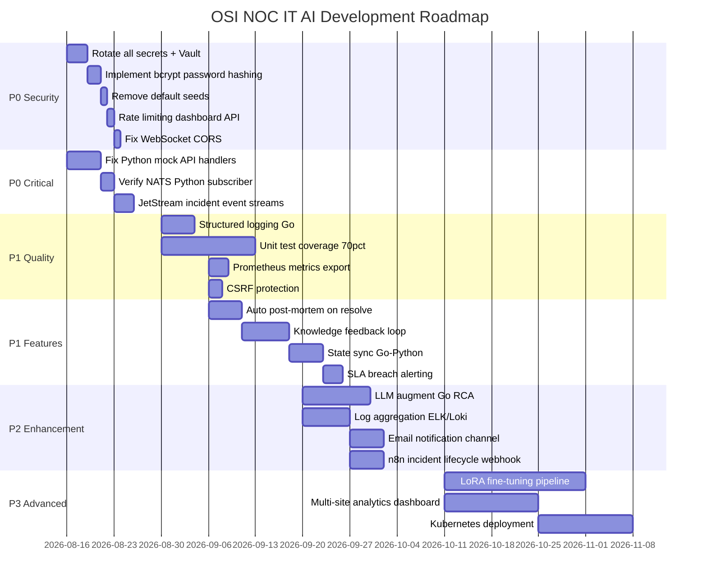

# DEVELOPMENT ROADMAP
## OSI NOC IT AI — Phased Development Roadmap P0 → P3
**Based on:** Full forensic audit findings  
**Priority Order:** P0 = Now, P1 = Next Sprint, P2 = This Quarter, P3 = Next Quarter

---

## ROADMAP OVERVIEW

---

## PHASE P0 — CRITICAL (Week 1-2) — MUST DO BEFORE PUBLIC DEPLOYMENT

### P0.1 Security Hardening
**Priority:** IMMEDIATE  
**Owner:** Backend Engineer + DevOps

| Task | File | Status | Est. |
|------|------|--------|------|
| Rotate ALL API keys (GEMINI, OPENAI, TELEGRAM, JWT) | .env | TODO | 1h |
| Move secrets to HashiCorp Vault or Doppler | .env → Vault | TODO | 4h |
| Implement bcrypt on rbac_users.password | schema.go + login handler | TODO | 4h |
| Remove default admin/admin seeds | schema.go L931-934 | TODO | 1h |
| Add rate limiting to /api/login (5 attempts/min) | dashboard_server.go | TODO | 2h |
| Fix WebSocket CheckOrigin to whitelist | server_ws.go | TODO | 1h |
| Remove hardcoded HMAC fallback key | incident_service.go L204 | TODO | 1h |
| Separate OSI_SECURITY_KEY into 4 env vars | docker-compose.yml | TODO | 3h |

### P0.2 Fix Python Mock Handlers
**Priority:** IMMEDIATE  
**Owner:** Python/AI Engineer

| Task | File | Status | Est. |
|------|------|--------|------|
| Wire `_handle_analyze()` to WorkflowOrchestrator | api_router.py L196 | TODO | 6h |
| Wire `_handle_execute_remediation()` to real execution | api_router.py L206 | TODO | 8h |
| Wire `_handle_rag_query()` to real RAGEngine | api_router.py L217 | TODO | 4h |
| Replace `_handle_models()` static list with live check | api_router.py L230 | TODO | 2h |
| Fix `_handle_health()` to do live component checks | api_router.py L148 | TODO | 4h |

### P0.3 NATS Reliability
**Priority:** IMMEDIATE  
**Owner:** Backend Engineer

| Task | File | Status | Est. |
|------|------|--------|------|
| Create named JetStream stream: INCIDENTS | ingestion_server.go | TODO | 3h |
| Migrate natsConn.Publish → natsJS.Publish | incident_service.go L290, L360 | TODO | 2h |
| Add ack handling for published events | incident_service.go | TODO | 3h |
| Verify Python NATS subscriber registration | run_orchestrator.py | TODO | 2h |

---

## PHASE P1 — HIGH PRIORITY (Week 3-6)

### P1.1 Code Quality
| Task | File | Est. |
|------|------|------|
| Replace fmt.Printf with slog (structured JSON) | All Go files | 8h |
| Add Prometheus metrics exporter | ingestion_server.go | 4h |
| Add CSRF protection middleware | dashboard_server.go | 4h |
| Enable PostgreSQL TLS (sslmode=require) | database.go | 2h |
| Set GORM logger to WARN level in production | database.go | 1h |

### P1.2 Testing
| Task | Files | Est. |
|------|-------|------|
| Unit tests for incident_service.go | incident_service_test.go | 12h |
| Unit tests for ai_engine.go | ai_engine_test.go | 8h |
| Unit tests for Python workflow_orchestrator | test_workflow_orchestrator.py | 10h |
| Integration tests for incident lifecycle | tests/integration/ | 16h |
| E2E tests with Playwright | playwright.config.js | 20h |

### P1.3 Features
| Task | Files | Est. |
|------|-------|------|
| Auto post-mortem on ResolveIncident() | incident_service.go + post_mortem_generator.py | 8h |
| Knowledge base update from resolved incidents | incident_service.go + knowledge_auto_builder.py | 12h |
| State sync Go-Python via shared incident_states | incident_service.go + execution_orchestrator.py | 16h |
| SLA breach detection + Telegram alert | schema.go sla_deadline + new service | 10h |
| Email notification channel | New email_service.go | 8h |

### P1.4 Observability
| Task | Files | Est. |
|------|-------|------|
| ELK/Loki log aggregation | docker-compose.yml + logstash | 12h |
| Grafana dashboard for key metrics | grafana/provisioning/ | 8h |
| OTel trace export to Jaeger | ingestion_server.go | 6h |
| Live health check for Python subcomponents | api_router.py | 4h |

---

## PHASE P2 — IMPORTANT (Month 2)

### P2.1 AI Enhancement
| Task | Files | Est. |
|------|-------|------|
| LLM augmentation for Go RCA (via Python API) | ai_engine.go → python_ai_core | 2 weeks |
| Python LLM E2E integration test | test suite | 1 week |
| Causal DAG auto-refresh from incident data | causal_dag_engine.py + incidents | 2 weeks |
| Critic engine integration with Go AI path | critic_engine.py | 1 week |

### P2.2 Features
| Task | Files | Est. |
|------|-------|------|
| n8n webhook on incident escalation | n8n_dispatcher.py | 1 week |
| LDAP/AD authentication | ldap_auth.go | 1 week |
| Multi-channel notification (Slack/Teams) | New notification_service.go | 1 week |
| Chrome extension incident viewer | chrome_extension/ | 2 weeks |
| DB read replica routing | database.go L269-274 (existing code) | 3 days |

### P2.3 Platform
| Task | Files | Est. |
|------|-------|------|
| PostgreSQL backup schedule (pg_dump + cron) | docker-compose.yml | 3 days |
| Redis AOF persistence config | docker/redis/redis.conf | 1 day |
| NATS JetStream per-stream retention policies | docker/nats/ | 2 days |
| Disaster recovery runbook documentation | docs/ | 3 days |

---

## PHASE P3 — ADVANCED (Month 3+)

### P3.1 Advanced AI
| Task | Files | Est. |
|------|-------|------|
| LoRA fine-tuning pipeline (real implementation) | lora_training_pipeline_orchestrator.py | 4 weeks |
| DPO dataset synthesis from operator feedback | dpo_dataset_synthesizer.py | 2 weeks |
| Federated learning across sites | cognition/federation/ | 6 weeks |
| Autonomous remediation in AUTONOMOUS mode | execution_orchestrator.py | 4 weeks |

### P3.2 Platform Scaling
| Task | Files | Est. |
|------|-------|------|
| Kubernetes deployment manifests | manifests/ | 2 weeks |
| Horizontal Pod Autoscaler for ingestion-server | manifests/ | 1 week |
| Multi-region deployment guide | docs/ | 1 week |
| RBAC multi-tenant per enterprise | schema.go tenant_id | 3 weeks |

### P3.3 Analytics & Reporting
| Task | Files | Est. |
|------|-------|------|
| Multi-site analytics dashboard | portal/ | 3 weeks |
| Automated monthly incident report PDF | Python + wkhtmltopdf | 2 weeks |
| Trend analysis and forecasting dashboard | portal/ + predictive_forecaster.py | 3 weeks |
| MTTR/SLA compliance reporting | New reporting service | 2 weeks |

---

## SUCCESS METRICS

| Metric | Current | Target P0 | Target P1 | Target P3 |
|--------|---------|-----------|-----------|-----------|
| Security Score | 40/100 | 75/100 | 85/100 | 95/100 |
| Test Coverage | <10% | 30% | 70% | 85% |
| Incident Detection Latency | < 500ms | < 500ms | < 300ms | < 200ms |
| AI Accuracy (predcode coverage) | 4 patterns | 4 patterns | 50+ patterns (LLM) | 500+ patterns |
| Post-mortem Auto-generation | 0% | 0% | 100% | 100% |
| Knowledge Growth from Incidents | 0% | 0% | 100% | 100% |
| System Production Readiness | 60/100 | 75/100 | 85/100 | 95/100 |
