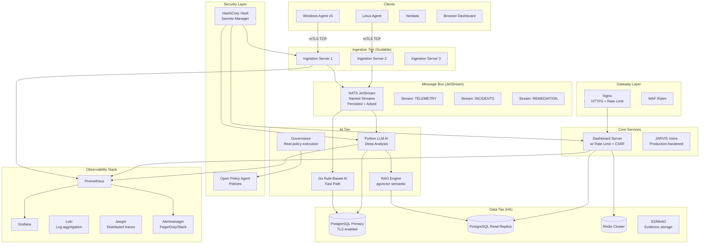

# FUTURE ARCHITECTURE
## OSI NOC IT AI — Recommended Future Architecture
**Based on:** Current audit findings and gaps  
**Status:** RECOMMENDATION — not implemented

---

## RECOMMENDED TARGET ARCHITECTURE

---

## KEY ARCHITECTURAL IMPROVEMENTS

### 1. Secrets Management
- HashiCorp Vault for all API keys, JWT secrets, DB passwords
- Dynamic short-lived credentials for DB (Vault database secrets engine)
- Secret rotation automation

### 2. Message Bus (JetStream)
- Named streams: TELEMETRY, INCIDENTS, REMEDIATION
- Durable consumers with explicit ack
- Consumer groups for load-balanced processing
- Subject hierarchy: `{domain}.{site}.{event_type}`

### 3. AI Two-Tier Decision
- **Tier 1 (< 200ms):** Go rule-based for immediate response
- **Tier 2 (< 2s):** Python LLM for deep analysis
- **Feedback loop:** Resolved incidents → knowledge base update
- **Quality gate:** Critic engine validates all AI decisions

### 4. State Management
- Single source of truth: `incident_states` table
- Event sourcing via `incident_events` with causal_chain
- Go and Python both read/write same `incident_states` row (with optimistic locking)

### 5. Observability
- Structured JSON logging with slog/zap (Go) + structlog (Python)
- Prometheus metrics + Grafana dashboards
- Loki log aggregation
- Jaeger distributed traces (OTel SDK)
- Alertmanager → PagerDuty + Telegram

### 6. Security
- Separate keys per service (no OSI_SECURITY_KEY reuse)
- bcrypt password hashing with 12 rounds
- CSRF tokens on all state-change endpoints
- WebSocket origin whitelist
- TLS everywhere (internal + external)
- mTLS for agent → ingestion server communication

### 7. Testing
- Unit tests: >80% coverage
- Integration tests: Full incident lifecycle
- Chaos tests: Kill individual services
- Performance tests: 10,000 events/second

### 8. Scaling
- Horizontal scaling of ingestion-server (3+ replicas)
- PostgreSQL read replica for analytics queries
- Redis Cluster for HA
- NATS cluster (3 nodes) for HA
