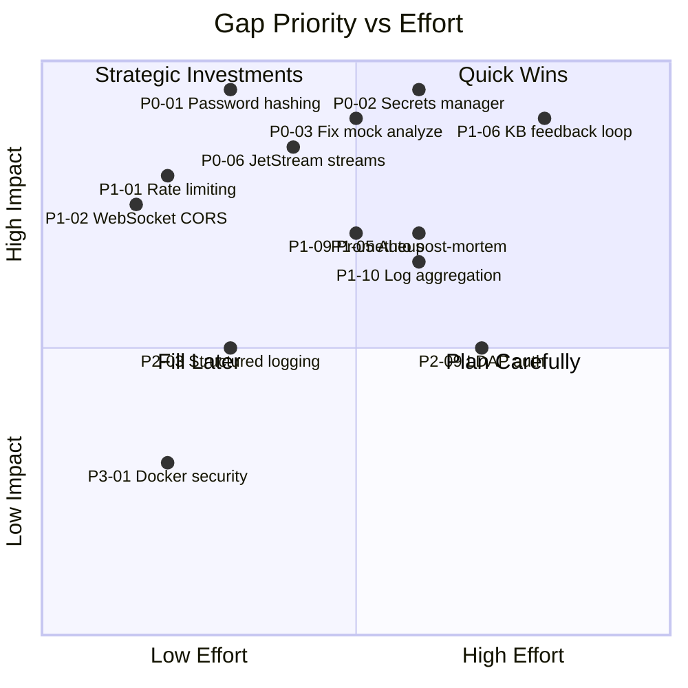

# GAP ANALYSIS
## OSI NOC IT AI — Current State vs Expected State
**Evidence:** Full source code audit  
**Status:** Evidence-based findings

---

## GAP ANALYSIS SUMMARY

Total gaps identified: **42**  
Critical (P0): **6**  
High (P1): **14**  
Medium (P2): **15**  
Low (P3): **7**

---

## CRITICAL GAPS (P0)

| # | Module | Gap | Current State | Expected State |
|---|--------|-----|---------------|----------------|
| P0-01 | Security | Passwords stored in plaintext | TEXT column, admin/admin seed | bcrypt/argon2 hashing |
| P0-02 | Security | API keys in plaintext .env | Exposed in .env file | Secrets manager (Vault/Doppler) |
| P0-03 | API | Python analyze endpoint is MOCK | Returns hardcoded response | Triggers real AI analysis |
| P0-04 | API | Python remediation is MOCK | Returns hardcoded SUCCESS | Executes actual remediation |
| P0-05 | AI | Go AI is rule-based (4 predcodes) | Keyword matching only | LLM-augmented semantic RCA |
| P0-06 | Reliability | NATS incident events have no persistence | Plain Publish(), no ack | JetStream with ack + persistence |

---

## HIGH GAPS (P1)

| # | Module | Gap | Current State | Expected State |
|---|--------|-----|---------------|----------------|
| P1-01 | Security | No rate limiting on Dashboard API | None | Per-IP rate limiting |
| P1-02 | Security | WebSocket CheckOrigin=true | All origins allowed | Whitelist-based CORS |
| P1-03 | Security | DB sslmode=disable | Unencrypted in transit | TLS required |
| P1-04 | AI | Python LLM incident path not verified E2E | NATS pub but subscriber unknown | Full verified E2E flow |
| P1-05 | Post-incident | No auto post-mortem on incident close | Manual only | Auto-triggered on ResolveIncident() |
| P1-06 | Knowledge | Resolved incidents don't update knowledge base | Static KB | Learning feedback loop |
| P1-07 | State | Go fleet_incidents and Python incident_states not synced | Two separate state machines | Single source of truth |
| P1-08 | SLA | SLA breach detection exists in schema but no alerting | Schema only | Active monitoring + notification |
| P1-09 | Observability | No Prometheus metrics | Custom /metrics endpoint | Prometheus/Grafana integration |
| P1-10 | Observability | No log aggregation | Per-container stdout | ELK/Loki centralized |
| P1-11 | Testing | No verified unit test coverage | Playwright config present | >70% coverage with CI |
| P1-12 | Keys | Same OSI_SECURITY_KEY for NATS/Redis/HMAC/Fernet | Single shared key | Separate keys per service |
| P1-13 | Email | No email notification on critical incidents | None | SMTP/SES integration |
| P1-14 | Escalation | Telegram failure blocks escalation | Hard error propagated | Retry + fallback channel |

---

## MEDIUM GAPS (P2)

| # | Module | Gap | Current State | Expected State |
|---|--------|-----|---------------|----------------|
| P2-01 | Security | No CSRF protection | None | CSRF token on state-change endpoints |
| P2-02 | AI | Python health check returns static status | Hardcoded "ONLINE" | Live component health check |
| P2-03 | Logging | Go uses fmt.Printf | Unstructured | Structured JSON logging (zap/slog) |
| P2-04 | NATS | JetStream initialized but no named streams | js object initialized | Named streams created on startup |
| P2-05 | AI | RetrainClassifier returns mocked metrics | Hardcoded 0.985 F1 | Real model training metrics |
| P2-06 | LoRA | Training pipeline is placeholder | PLACEHOLDER file | Real fine-tuning pipeline |
| P2-07 | Multi-site | site_id routing working but cross-site correlation not verified | Single-site tested | Multi-site fleet correlation |
| P2-08 | n8n | n8n workflow integration not connected to incident lifecycle | Dispatcher class exists | n8n webhook triggered on incidents |
| P2-09 | LDAP | LDAP auth stub (600 bytes) | Not implemented | LDAP/AD authentication |
| P2-10 | Read replica | DB read replica code present but disabled | Commented out | Active read replica for reporting |
| P2-11 | Backup | No backup strategy in docker-compose | Volumes only | pg_dump + volume backup schedule |
| P2-12 | Chat | WebSocket reconnect logic not verified in browser | Unknown | Auto-reconnect with backoff |
| P2-13 | Agent | Agent push silently dropped if device offline | No retry | Queue + retry for offline agents |
| P2-14 | AI | ai_audit_trail write path from Go not verified | Schema exists | Go writes audit trail entries |
| P2-15 | Fleet | CMDB assets not linked to incident lifecycle | CMDB table exists | CMDB CI in incident context |

---

## LOW GAPS (P3)

| # | Module | Gap | Current State | Expected State |
|---|--------|-----|---------------|----------------|
| P3-01 | Docker | workspace:rw mount in dashboard-server | Read-write | Read-only where possible |
| P3-02 | Docker | docker.sock exposed in dashboard-server | Mounted | Sockguard or alternative |
| P3-03 | DB | advisory lock may block on concurrent migrations | Blocking lock | Non-blocking migration approach |
| P3-04 | Naming | fleet_evidence.s3_path used for local path | Misleading name | Rename to file_path or storage_path |
| P3-05 | Observability | pprof server always started | Always on | Behind feature flag |
| P3-06 | Notification | Single Telegram chat for all sites | One group | Per-site Telegram groups |
| P3-07 | AI | No hallucination detection in Go path | No validation | Confidence threshold + cross-check |

---

## GAP PRIORITY MATRIX

---

## WHAT IS WORKING WELL (VERIFIED)

| Feature | Implementation Quality |
|---------|----------------------|
| TCP-based telemetry ingestion | EXCELLENT — 8 workers, SO_REUSEPORT, site-sharded queues |
| Agent token authentication (HMAC) | GOOD |
| Telemetry integrity scoring | GOOD — mathematical model |
| Incident deduplication | GOOD — idempotency key |
| Database schema design | EXCELLENT — 60+ tables, pgvector, full audit |
| RBAC system | GOOD — roles, permissions, audit trail |
| WebSocket real-time chat | GOOD — Redis PubSub bridge |
| Telegram notifications | GOOD — multi-scenario messages |
| Agent push notifications | GOOD — bypass command system |
| Governance policy matrix | GOOD — NOTIFY/TICKET/RESTART policies |
| Circuit breaker / retry | GOOD — well-implemented in Python |
| Flat-line + stale telemetry detector | GOOD — Phase 2 anomaly detection |
| Adaptive RoC detector | GOOD — Phase 3 spike/drop detection |
| State hash drift detector | GOOD — gradual drift detection |
| Fleet site partitioning | GOOD — multi-tenant support |
