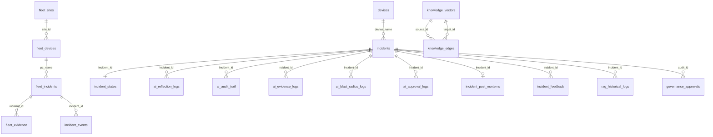

# INCIDENT DATA MODEL
## OSI NOC IT AI — Incident-Related Database Entities
**Evidence:** SERVER/go_core/database/schema.go (1422 lines), SERVER/go_core/database/database.go  
**Database:** PostgreSQL 15 + pgvector  
**Status:** VERIFIED from schema.go DDL definitions

---

## CORE INCIDENT ENTITIES

### 1. fleet_incidents (Primary Incident Table — Fleet/User-facing)
```sql
CREATE TABLE fleet_incidents (
    incident_id SERIAL PRIMARY KEY,
    site_id TEXT REFERENCES fleet_sites(site_id) ON DELETE SET NULL,
    pc_name TEXT REFERENCES fleet_devices(pc_name) ON DELETE SET NULL,
    severity TEXT DEFAULT 'LOW',           -- LOW, MEDIUM, HIGH, CRITICAL
    status TEXT DEFAULT 'OPEN',            -- OPEN, RESOLVED
    description TEXT,
    created_at TIMESTAMP DEFAULT CURRENT_TIMESTAMP,
    resolved_at TIMESTAMP,
    -- Added via ALTER:
    trace_id TEXT,
    policy_snapshot_id TEXT,
    state_version INTEGER DEFAULT 1
)
```
**Used by:** incident_service.go TriggerIncidentWorkflow(), EscalateIncident(), ResolveIncident()  
**Status:** VERIFIED

---

### 2. incidents (Core Network Incidents — AI/Infrastructure-facing)
```sql
CREATE TABLE incidents (
    incident_id SERIAL PRIMARY KEY,
    timestamp TIMESTAMP DEFAULT CURRENT_TIMESTAMP,
    device_name TEXT REFERENCES devices(name) ON DELETE SET NULL,
    layer INTEGER,            -- OSI layer
    flag TEXT,                -- incident type/flag
    evidence TEXT,
    raw_data JSONB,
    confidence FLOAT,
    rag_status TEXT DEFAULT 'GREEN'  -- GREEN, AMBER, RED
    -- Added via ALTER:
    trace_id TEXT,
    policy_snapshot_id TEXT,
    reasoning_trace JSONB
)
```
**Used by:** Python AI core, Go ai_engine.go  
**Status:** VERIFIED

---

### 3. incident_states (State Machine — Python AI)
```sql
CREATE TABLE incident_states (
    state_id SERIAL PRIMARY KEY,
    incident_id INTEGER UNIQUE REFERENCES incidents(incident_id) ON DELETE CASCADE,
    device_name TEXT REFERENCES devices(name) ON DELETE CASCADE,
    flag TEXT NOT NULL,
    status TEXT NOT NULL DEFAULT 'TRIGGERED',    -- TRIGGERED, INVESTIGATING, REMEDIATED, RESOLVED, FAILED
    severity TEXT DEFAULT 'MEDIUM',
    sla_minutes INTEGER DEFAULT 60,
    sla_deadline TIMESTAMP,
    sla_breached BOOLEAN DEFAULT FALSE,
    reopen_window_end TIMESTAMP,
    last_updated TIMESTAMP DEFAULT CURRENT_TIMESTAMP,
    resolved_at TIMESTAMP,
    rag_status TEXT DEFAULT 'GREEN'
)
```
**Used by:** execution_orchestrator.py  
**Status:** VERIFIED (schema only — Python side verification needed)

---

### 4. incident_events (Event Sourcing)
```sql
CREATE TABLE incident_events (
    event_id SERIAL PRIMARY KEY,
    incident_id TEXT NOT NULL,
    event_type TEXT NOT NULL,    -- CREATED, ESCALATED, RESOLVED, etc.
    payload JSONB,
    created_at TIMESTAMP DEFAULT CURRENT_TIMESTAMP,
    -- Added via ALTER:
    trace_id TEXT,
    site_id TEXT DEFAULT 'global',
    causal_chain TEXT[]
)
```
**Used by:** incident_service.go (INSERT on CREATED)  
**Status:** VERIFIED

---

### 5. fleet_evidence (Evidence Collection)
```sql
CREATE TABLE fleet_evidence (
    evidence_id SERIAL PRIMARY KEY,
    incident_id INTEGER REFERENCES fleet_incidents(incident_id) ON DELETE CASCADE,
    evidence_type TEXT,    -- SCREENSHOT
    s3_path TEXT,         -- Local file path (not S3 despite column name)
    timestamp TIMESTAMP DEFAULT CURRENT_TIMESTAMP
)
```
**Note:** Column named `s3_path` but used for local file paths  
**Used by:** incident_service.go goroutine (screenshot)  
**Status:** VERIFIED

---

## AI/ANALYSIS ENTITIES

### 6. ai_audit_trail (Full AI Decision Record)
```sql
CREATE TABLE ai_audit_trail (
    audit_id SERIAL PRIMARY KEY,
    incident_id INTEGER REFERENCES incidents(incident_id) ON DELETE CASCADE,
    event_id TEXT UNIQUE NOT NULL,
    reasoning_dag JSONB,
    rag_vectors_retrieved JSONB,
    raw_prompt TEXT,
    llm_response TEXT,
    confidence_score REAL,
    action_executed TEXT,
    operator_feedback TEXT,
    reasoning_trace JSONB,
    planning_trace JSONB,
    policy_trace JSONB,
    memory_trace JSONB,
    worker_state TEXT,
    execution_time_ms INTEGER,
    created_at TIMESTAMP DEFAULT CURRENT_TIMESTAMP
)
```
**Status:** VERIFIED (schema) — actual write path from Python not verified

---

### 7. ai_reflection_logs (Multi-Hypothesis Tracking)
```sql
CREATE TABLE ai_reflection_logs (
    id SERIAL PRIMARY KEY,
    incident_id INTEGER REFERENCES incidents(incident_id) ON DELETE CASCADE,
    timestamp TIMESTAMP DEFAULT CURRENT_TIMESTAMP,
    stage_version TEXT,
    first_hypothesis TEXT,
    second_hypothesis TEXT,
    final_decision TEXT,
    confidence_score REAL,
    ai_models_used TEXT,
    decision_time_ms INTEGER,
    -- Added via ALTER:
    trace_id TEXT, span_id TEXT, parent_span TEXT
)
```
**Status:** VERIFIED (schema) — write path PARTIALLY_IMPLEMENTED

---

### 8. ai_evidence_logs (Evidence Used in Analysis)
```sql
CREATE TABLE ai_evidence_logs (
    id SERIAL PRIMARY KEY,
    incident_id INTEGER REFERENCES incidents(incident_id) ON DELETE CASCADE,
    evidence_type TEXT,
    evidence_data JSONB,
    validation_status TEXT,
    source_system TEXT,
    evidence_hash TEXT
)
```

### 9. ai_blast_radius_logs (Impact Assessment)
```sql
CREATE TABLE ai_blast_radius_logs (
    id SERIAL PRIMARY KEY,
    incident_id INTEGER REFERENCES incidents(incident_id) ON DELETE CASCADE,
    impacted_sites INTEGER,
    impacted_pcs INTEGER,
    impacted_printers INTEGER,
    impacted_dashboards INTEGER,
    impact_level TEXT
)
```

### 10. ai_approval_logs (Human Approval Tracking)
```sql
CREATE TABLE ai_approval_logs (
    id SERIAL PRIMARY KEY,
    incident_id INTEGER REFERENCES incidents(incident_id) ON DELETE CASCADE,
    risk_level TEXT,
    action_name TEXT,
    approved_by TEXT,
    approved_role TEXT,
    approved_at TIMESTAMP,
    approval_expiry TIMESTAMP,
    approval_status TEXT
)
```

---

## KNOWLEDGE / RAG ENTITIES

### 11. knowledge_vectors (RAG Knowledge Base)
```sql
CREATE TABLE knowledge_vectors (
    incident_id TEXT PRIMARY KEY,
    title TEXT,
    symptoms TEXT,
    root_cause TEXT,
    resolution TEXT,
    embedding vector(768),    -- pgvector — 768-dim embedding
    confidence FLOAT,
    created_at TIMESTAMP DEFAULT CURRENT_TIMESTAMP,
    tags TEXT[]
    -- fallback: embedding TEXT if pgvector not available
)
-- Indexes:
-- HNSW (hnsw vector_cosine_ops) for semantic search
-- GIN FTS for full-text search
```
**Status:** VERIFIED (schema) — actual vector write from Go uses TEXT fallback

---

### 12. knowledge_edges (Graph Relationships)
```sql
CREATE TABLE knowledge_edges (
    source_id TEXT REFERENCES knowledge_vectors(incident_id) ON DELETE CASCADE,
    target_id TEXT REFERENCES knowledge_vectors(incident_id) ON DELETE CASCADE,
    relationship_type VARCHAR(50) NOT NULL,
    weight DOUBLE PRECISION DEFAULT 1.0,
    co_occurrence_count INTEGER DEFAULT 1,
    last_reinforced_at TIMESTAMP DEFAULT CURRENT_TIMESTAMP,
    PRIMARY KEY (source_id, target_id, relationship_type)
)
```

---

## GOVERNANCE / APPROVAL ENTITIES

### 13. governance_approvals
```sql
CREATE TABLE governance_approvals (
    approval_id SERIAL PRIMARY KEY,
    audit_id INTEGER,
    required_role TEXT NOT NULL,
    approved_by TEXT,
    status TEXT DEFAULT 'PENDING',    -- PENDING, APPROVED, REJECTED
    created_at TIMESTAMP DEFAULT CURRENT_TIMESTAMP,
    resolved_at TIMESTAMP
)
```

### 14. approval_queue
```sql
CREATE TABLE approval_queue (
    id SERIAL PRIMARY KEY,
    incident_id INTEGER REFERENCES incidents(incident_id) ON DELETE CASCADE,
    action_name TEXT NOT NULL,
    risk_level TEXT NOT NULL,
    status TEXT DEFAULT 'PENDING',
    version INTEGER DEFAULT 1,   -- Optimistic locking
    created_at TIMESTAMP DEFAULT CURRENT_TIMESTAMP
)
```

### 15. approval_outbox (Outbox Pattern for Reliability)
```sql
CREATE TABLE approval_outbox (
    id BIGSERIAL PRIMARY KEY,
    event_type TEXT NOT NULL,
    aggregate_id BIGINT NOT NULL,
    payload JSONB NOT NULL,
    status TEXT DEFAULT 'PENDING',
    created_at TIMESTAMP DEFAULT CURRENT_TIMESTAMP,
    sent_at TIMESTAMP NULL,
    retry_count INTEGER DEFAULT 0,
    publish_ack BOOLEAN DEFAULT FALSE,
    last_error TEXT NULL
)
```

---

## RESOLUTION / POST-INCIDENT ENTITIES

### 16. incident_post_mortems
```sql
CREATE TABLE incident_post_mortems (
    post_mortem_id SERIAL PRIMARY KEY,
    incident_id INTEGER UNIQUE REFERENCES incidents(incident_id) ON DELETE CASCADE,
    device_name TEXT REFERENCES devices(name) ON DELETE CASCADE,
    flag TEXT,
    mttr_seconds INTEGER,
    blast_radius TEXT,
    rca_summary TEXT,
    remediation_effectiveness TEXT,
    prevention_steps TEXT[],
    report_data JSONB,
    created_at TIMESTAMP DEFAULT CURRENT_TIMESTAMP
)
```
**Status:** VERIFIED (schema) — **auto-generation NOT wired to ResolveIncident()**

### 17. post_incident_debriefs
```sql
CREATE TABLE post_incident_debriefs (
    id SERIAL PRIMARY KEY,
    incident_id TEXT NOT NULL,
    is_rca_correct BOOLEAN DEFAULT TRUE,
    external_factors TEXT,
    operator_feedback TEXT,
    submitted_by TEXT DEFAULT 'NOC_OPERATOR',
    submitted_at TIMESTAMP DEFAULT CURRENT_TIMESTAMP
)
```

### 18. incident_feedback (AI Learning Loop)
```sql
CREATE TABLE incident_feedback (
    feedback_id SERIAL PRIMARY KEY,
    incident_id INTEGER REFERENCES incidents(incident_id) ON DELETE CASCADE,
    ai_root_cause TEXT,
    human_root_cause TEXT,
    score FLOAT,
    reviewer TEXT,
    created_at TIMESTAMP DEFAULT CURRENT_TIMESTAMP,
    -- Added via ALTER:
    feedback_state TEXT DEFAULT 'PENDING',  -- APPROVED_SUCCESS, APPROVED_FAILED, ROLLED_BACK
    correlation_id TEXT,
    trace_id TEXT,
    knowledge_version INTEGER DEFAULT 1,
    policy_version INTEGER DEFAULT 1,
    status TEXT DEFAULT 'APPROVED',
    rejection_reason TEXT,
    ai_rca TEXT,
    human_rca TEXT
)
```

---

## ENTITY RELATIONSHIP DIAGRAM



---

## DATA MODEL GAPS

| Gap | Impact | Risk |
|-----|--------|------|
| fleet_incidents and incidents are SEPARATE tables with different structures | AI writes to incidents, Go writes to fleet_incidents — no join | HIGH |
| fleet_evidence.s3_path used for local path (naming misleading) | Future S3 migration confusion | LOW |
| incident_events.incident_id is TEXT (not INTEGER FK to fleet_incidents) | No referential integrity | MEDIUM |
| post_mortem NOT triggered automatically on ResolveIncident() | Post-mortems require manual creation | MEDIUM |
| SLA tracking exists in schema but no enforcement code verified | SLA monitoring gap | HIGH |
