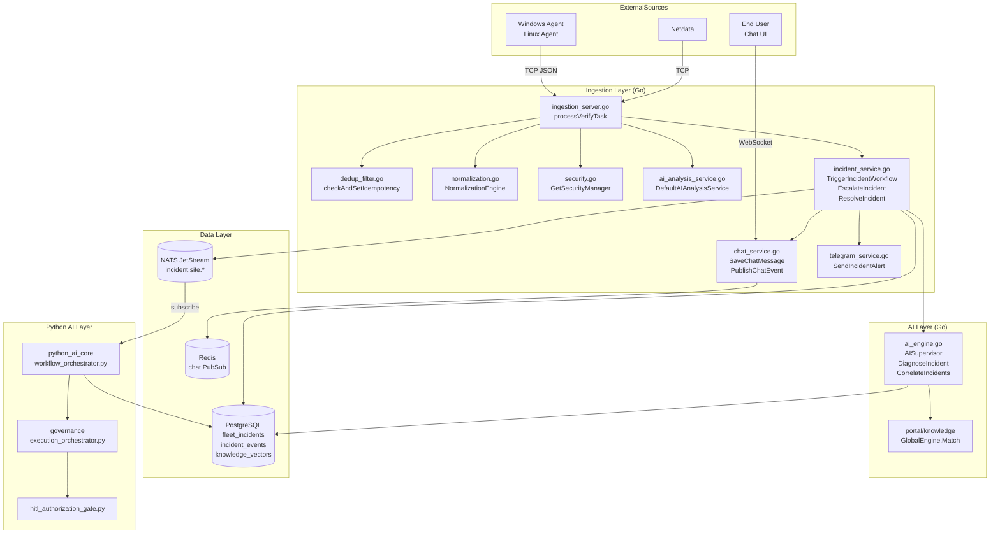

# INCIDENT DEPENDENCY MAP
## OSI NOC IT AI — Module Dependency Graph for Incident Processing
**Evidence:** Source code import analysis, function call tracing  
**Status:** VERIFIED from code analysis

---

## DEPENDENCY GRAPH: Incident Processing Chain



---

## MODULE DEPENDENCY TABLE

| Module | Depends On | Type | Status |
|--------|-----------|------|--------|
| ingestion_server.go | database/database.go | CORE | VERIFIED |
| ingestion_server.go | security/security.go | CORE | VERIFIED |
| ingestion_server.go | config/config.go | CORE | VERIFIED |
| ingestion_server.go | hardening/ | CORE | VERIFIED |
| ingestion_server.go | incident_service.go | CORE | VERIFIED |
| ingestion_server.go | dedup_filter.go | CORE | VERIFIED |
| ingestion_server.go | normalization.go | CORE | VERIFIED |
| ingestion_server.go | nats.go | INFRA | VERIFIED |
| ingestion_server.go | redis | INFRA | VERIFIED |
| incident_service.go | database/database.go | CORE | VERIFIED |
| incident_service.go | chat_service.go | CORE | VERIFIED |
| incident_service.go | telegram_service.go | NOTIFICATION | VERIFIED |
| incident_service.go | ai_analysis_service.go | AI | VERIFIED |
| incident_service.go | portal/knowledge (GlobalEngine) | KNOWLEDGE | VERIFIED |
| incident_service.go | nats.go (via package var) | INFRA | VERIFIED |
| ai_analysis_service.go | ai_engine.go (AISupervisor) | AI | VERIFIED |
| ai_engine.go | database/database.go | DATA | VERIFIED |
| portal/knowledge | database (knowledge_vectors table) | DATA | VERIFIED |
| workflow_orchestrator.py | db_connector.py | DATA | VERIFIED |
| workflow_orchestrator.py | intent_router.py | ROUTING | VERIFIED |
| workflow_orchestrator.py | gpt_connector.py | AI | VERIFIED |
| workflow_orchestrator.py | event_correlation_engine.py | ANALYSIS | VERIFIED |
| workflow_orchestrator.py | nlu_engine.py | AI | VERIFIED |
| noc_bridge.py | Dashboard Server HTTP API | HTTP | VERIFIED |

---

## CRITICAL PATH (SHORTEST VERIFIED PATH)

```
Windows Agent → TCP :18800
  → ingestion_server.go:processVerifyTask()
    → incident_service.go:TriggerIncidentWorkflow()
      → ai_engine.go:DiagnoseIncident()
      → chat_service.go:SaveChatMessage()
      → Redis PubSub
        → Dashboard WebSocket
          → Client Chat UI
```
**Estimated Latency:** < 500ms (rule-based AI, no LLM call)

---

## DEPENDENCY RISKS

| Risk | Modules Affected | Severity |
|------|-----------------|---------|
| `natsConn` is package-level var, nil if NATS down | incident_service.go EscalateIncident, ResolveIncident | MEDIUM — gracefully guarded |
| `database.DB` is global singleton, no connection retry | All ingestion modules | HIGH — fail-fast on start |
| `DefaultAIAnalysisService` singleton, no failover | incident_service.go | MEDIUM — process continues without AI |
| `knowledge.GlobalEngine` loaded at startup, static | incident_service.go | MEDIUM — stale knowledge |
| Python AI Core can't access Go internal variables | PAC ↔ IS gap | HIGH — no shared state |
| Redis nil check missing in some publish paths | chat_service.go | LOW — investigate |

---

## CIRCULAR DEPENDENCY ANALYSIS

| Finding | Status |
|---------|--------|
| No circular imports detected in Go ingestion layer | VERIFIED CLEAN |
| Python ai_core has multiple try/except import fallbacks | ACCEPTABLE |
| Portal imports from SERVER/go_core | VERIFIED — one-directional |
| No circular Python module imports detected in core paths | VERIFIED CLEAN |

---

## LEAF MODULES (No further dependencies in incident path)

| Module | Role |
|--------|------|
| schema.go | DDL only, no logic |
| normalization.go | Pure transformation |
| dedup_filter.go | Redis state check |
| enterprise_log_parser.go | Log parsing only |
| site_partitioner.go | Site routing only |
