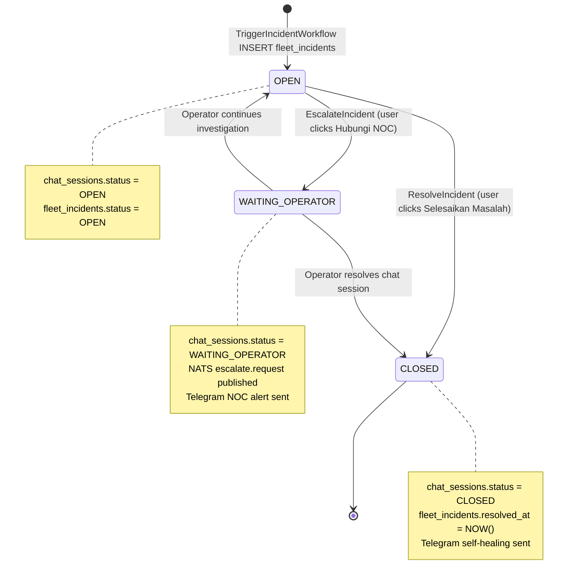

# INCIDENT LIFECYCLE
## OSI NOC IT AI — Full Incident Lifecycle Trace
**Evidence:** incident_service.go, ingestion_server.go, ai_engine.go, execution_orchestrator.py  
**Method:** Source-code end-to-end trace

---

## COMPLETE INCIDENT LIFECYCLE (VERIFIED PHASES)

```mermaid
flowchart TD
    A[1. DETECTION\nWindows Agent sends\nservice_alert / network_alert] --> B
    B[2. INGESTION\nTCP :18800 received\nprocessVerifyTask] --> C
    C[3. VALIDATION GATE\nSchema + HMAC Token\n+ Integrity Score] --> D
    D{Score >= 0.40?}
    D -->|NO| DLQ[DLQ — Dead Letter Queue\nPostgreSQL dlq_hybrid]
    D -->|YES| E
    E[4. DEDUPLICATION\ncheckAndSetIdempotency\nprocessed_messages table] --> F
    F{Duplicate?}
    F -->|YES| SKIP[DUPLICATE_IGNORED response]
    F -->|NO| G
    G[5. DEVICE REGISTRATION\nensureDeviceRegistered\nfleet_devices + devices tables] --> H
    H[6. INCIDENT CREATION\nfleet_incidents INSERT\nincident_events INSERT\nchat_sessions GET/CREATE] --> I
    I[7. INITIAL NOTIFICATION\nChat Message 1:\nAI Detecting...] --> J
    J[8. AI ANALYSIS\nDiagnoseIncident\nCorrelateIncidents\nQueryRAG\nCheckFleetCorrelation] --> K
    K[9. AI REPORT\nChat Message 2:\nAnalysis Report] --> L
    L[10. REMEDIATION GUIDE\nChat Message 3:\nStep-by-step remediation\nKnowledge Base Match] --> M
    M[11. AGENT PUSH\nSHOW_NOTIFICATION\nSHOW_CHAT via TCP :10000] --> N
    N[12. SCREENSHOT REQUEST\nWebSocket capture_screenshot\n4s timeout] --> O
    O{User Action?}
    O -->|Selesaikan Masalah| RESOLVE
    O -->|Hubungi NOC| ESCALATE
    O -->|No action| WAIT[Session stays OPEN]

    ESCALATE --> P[13. ESCALATION\nnatsConn.Publish escalate.request\nchat_sessions WAITING_OPERATOR]
    P --> Q[14. TELEGRAM ALERT\nSendIncidentAlert\nNOC Group notification]
    Q --> R[15. HUMAN REVIEW\nNOC Operator joins chat\nOperator chat messages]
    R --> RESOLVE

    RESOLVE --> S[16. RESOLUTION\nchat_sessions CLOSED\nfleet_incidents resolved_at]
    S --> T[17. TELEGRAM CONFIRMATION\nSELF-HEALING SUCCESS message]
    T --> U[18. POST-INCIDENT\nPost-mortem (planned)\nKnowledge update (planned)]
```

---

## PHASE-BY-PHASE VERIFICATION TABLE

| Phase | Description | Implementation File | Function | Status |
|-------|-------------|---------------------|----------|--------|
| 1. Detection | Agent anomaly detected | Windows agent (client) | agent telemetry sender | VERIFIED (external) |
| 2. Ingestion | TCP packet received | ingestion_server.go | startListenerPipeline(), handleTCPConnection() | VERIFIED |
| 3. Validation Gate | Schema + Token + Integrity | ingestion_server.go | validateTelemetrySchema(), verifyToken(), scoreTelemetryIntegrity() | VERIFIED |
| 4. Deduplication | Check processed_messages | ingestion_server.go | checkAndSetIdempotency() | VERIFIED |
| 5. Device Registration | Upsert devices/fleet_devices | ingestion_server.go | ensureDeviceRegistered() | VERIFIED |
| 6. Incident Creation | INSERT fleet_incidents, events | incident_service.go | TriggerIncidentWorkflow() L113-124 | VERIFIED |
| 7. Initial Notification | Chat message via Redis | incident_service.go | SaveChatMessage(), PublishChatEvent() L129-135 | VERIFIED |
| 8. AI Analysis | Rule-based RCA | incident_service.go → ai_engine.go | Analyze() → DiagnoseIncident() L138 | VERIFIED |
| 9. AI Report | Chat message 2 | incident_service.go | SaveChatMessage(), PublishChatEvent() L142-148 | VERIFIED |
| 10. Remediation Guide | KB match + guide | incident_service.go | knowledge.GlobalEngine.Match() L153 | VERIFIED |
| 11. Agent Push | SHOW_NOTIFICATION + SHOW_CHAT | incident_service.go | sendBypassCommandToAgent() L214, 228 | VERIFIED |
| 12. Screenshot | WebSocket request | incident_service.go | SendWSCommand("capture_screenshot") L239 | VERIFIED |
| 13. Escalation | NATS publish + status update | incident_service.go | EscalateIncident() L290, L294 | VERIFIED |
| 14. Telegram Alert | NOC group notification | incident_service.go | SendIncidentAlert() L319 | VERIFIED |
| 15. Human Review | NOC operator chat | chat_engine.go (portal) | Operator message handler | VERIFIED |
| 16. Resolution | DB close + session update | incident_service.go | ResolveIncident() L364 | VERIFIED |
| 17. Self-healing Telegram | Confirmation to NOC | incident_service.go | SendIncidentAlert("Self-Healing") L375 | VERIFIED |
| 18. Post-Incident Analysis | Post-mortem generation | governance/post_mortem_generator.py | PostMortemGenerator | PARTIALLY_IMPLEMENTED |
| 19. Knowledge Update | RAG/knowledge update | python_ai_core/knowledge/ | KnowledgeFabric | PARTIALLY_IMPLEMENTED |

---

## INCIDENT STATE TRANSITIONS



### State Machine Source
- `chat_sessions.status`: Managed by `incident_service.go`
- `fleet_incidents.status`: Set to 'OPEN' at creation, `resolved_at` set on close
- `incident_states.status`: Managed by Python `execution_orchestrator.py` (TRIGGERED → INVESTIGATING → RESOLVED)
- Both Go and Python maintain SEPARATE state tracking — **RISK: State sync gap**

---

## DETAILED CALL CHAIN: Incident Detection to User Notification

```
[Windows Agent TCP packet]
  ↓
startListenerPipeline(18800) — ingestion_server.go
  ↓
handleTCPConnection(conn) — ingestion_server.go
  ↓
verifyQueue ← verifyTask{conn, text, ipAddr}
  ↓
processVerifyTask(conn, text, ipAddr) — ingestion_server.go
  ├── json.Unmarshal() → TelemetryItem
  ├── InjectOTelContext() [trace_id, span_id, correlation_id]
  ├── isVersionAllowed() [agent version check]
  ├── validateTelemetrySchema() [required fields]
  ├── verifyToken() [HMAC-SHA256 check]
  ├── scoreTelemetryIntegrity() [0.0-1.0 score]
  └── checkAndSetIdempotency() [processed_messages dedup]
        ↓
handlePhase1Alert(item) — ingestion_server.go
  ├── ensureDeviceRegistered(item)
  │     → INSERT/UPDATE devices + fleet_devices
  └── DefaultIncidentService.TriggerIncidentWorkflow(pcName, severity, desc)
        ↓
TriggerIncidentWorkflow() — incident_service.go
  ├── Cooldown check: fleet_incidents WHERE created_at > 2min ago
  ├── Get/create: chat_sessions WHERE pc_name=?
  ├── INSERT fleet_incidents (site_id, pc_name, severity, status, description)
  ├── SELECT LASTVAL() → incidentID
  ├── INSERT incident_events (CREATED event)
  ├── SaveChatMessage("Saya mendeteksi gangguan...") → PublishChatEvent()
  │     → Redis PUBLISH chat:{clientID} → WebSocket → Client UI
  ├── DefaultAIAnalysisService.Analyze(description, "")
  │     → ai_engine.go:DiagnoseIncident()
  │         → CorrelateIncidents(alerts) [keyword matching]
  │         → QueryRAG(stitchedQuery, 3) [PostgreSQL LIKE search]
  │         → CheckFleetCorrelation(ctx, predCode) [fleet cross-device]
  │         → Confidence score calculation
  │         → returns DiagnosisResult + reportText
  ├── SaveChatMessage(AI report) → PublishChatEvent()
  ├── knowledge.GlobalEngine.Match(desc + cause) → kbMatch?
  │     → IF kbMatch: Use KB remediation steps
  │     → ELSE: BuildUserFriendlyRemediation(cause, reason, action, severity)
  ├── SaveChatMessage(remediation guide) → PublishChatEvent()
  ├── goroutine:
  │     → SELECT ip FROM devices WHERE name=pcName
  │     → sendBypassCommandToAgent(clientIP, SHOW_NOTIFICATION_payload)
  │     → sendBypassCommandToAgent(clientIP, SHOW_CHAT_payload)
  └── goroutine:
        → SendWSCommand(clientID, "capture_screenshot", {incident_id})
        → Wait 4s for screenshot path
        → INSERT fleet_evidence (SCREENSHOT) if received
```

---

## GAPS IN LIFECYCLE

| Phase | Gap | Impact | Priority |
|-------|-----|--------|----------|
| Phase 8 (AI Analysis) | Go AI uses rule-based, NOT LLM | AI quality limited to 4 predcodes | P1 HIGH |
| Phase 18 (Post-mortem) | post_mortem_generator.py not wired to incident close | No automatic post-mortem | P2 MEDIUM |
| Phase 19 (Knowledge Update) | No verified path from resolved incident to knowledge_vectors | Knowledge base doesn't grow from incidents | P1 HIGH |
| State Sync | Go fleet_incidents.status and Python incident_states.status maintained separately | Risk of diverged state | P1 HIGH |
| Escalation Python | NATS subscriber in Python not fully verified | Python may not process escalation events | P2 MEDIUM |
| SLA tracking | sla_deadline in incident_states but no SLA breach alerting verified | SLA breaches may be silent | P2 MEDIUM |
