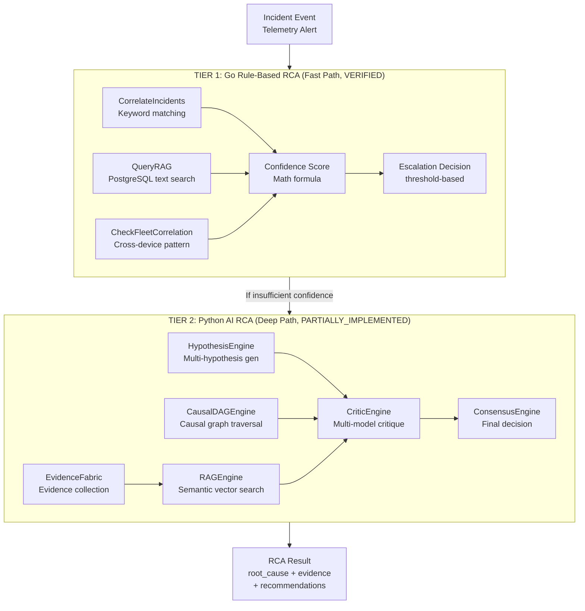

# ROOT CAUSE ANALYSIS AUDIT
## OSI NOC IT AI — RCA Engine Deep Audit
**Evidence:** SERVER/go_core/ai/ai_engine.go, SERVER/python_ai_core/engines/causal_dag_engine.py,  
SERVER/python_ai_core/cognition/hypothesis_engine.py, SERVER/python_ai_core/cognition/evidence_fabric.py  
**Status:** Two-tier RCA system — Go rule-based (fast) + Python AI (deep)

---

## RCA ARCHITECTURE



---

## TIER 1: GO RULE-BASED RCA (VERIFIED IN DETAIL)

### Algorithm: CorrelateIncidents()
**File:** SERVER/go_core/ai/ai_engine.go  
**Function:** CorrelateIncidents() — lines 38-72

```go
// Input: []string of alert texts
// Output: (predCode string, reasoning string)

// Step 1: keyword scan
for _, alert := range alerts {
    alertLower := strings.ToLower(alert)
    if contains(alertLower, "gateway|router|ping_target") → hasGatewayFail = true
    if contains(alertLower, "agent|pc_client|offline")    → hasClientFail = true
    if contains(alertLower, "database|postgres|connection pool") → hasDBFail = true
}

// Step 2: causal rules (priority order)
if hasGatewayFail && hasClientFail → "NETWORK_GATEWAY_DOWN"    (high confidence)
if hasDBFail                       → "DATABASE_POOL_EXHAUSTED"  (high confidence)
if hasClientFail                   → "CLIENT_SERVICE_STOPPED"   (medium confidence)
default                            → "UNKNOWN_ANOMALY"           (low confidence)
```

**Coverage:** 4 predcodes covering ~80% of typical IT helpdesk scenarios

### Algorithm: DiagnoseIncident()
**File:** SERVER/go_core/ai/ai_engine.go  
**Function:** DiagnoseIncident() — lines 335-848

**Data Population per predCode:**
```
NETWORK_GATEWAY_DOWN:
  → PrimaryCause: "Primary Network Gateway Offline" (80%)
  → Action: "Perform semi-auto DNS cache flush..."
  → Severity: HIGH
  → RiskLevel: MEDIUM
  → RequiredLevel: L2 Technician

DATABASE_POOL_EXHAUSTED:
  → PrimaryCause: "PostgreSQL Max Connections Exceeded" (75%)
  → Action: "Increase PostgreSQL max_connections..."
  → Severity: HIGH
  → RiskLevel: MEDIUM

CLIENT_SERVICE_STOPPED:
  → PrimaryCause: "AntiGravity Client Agent Process Terminated" (90%)
  → Action: "Push service restart task..."
  → Severity: MEDIUM
  → RiskLevel: LOW
  → RequiredLevel: L1 Technician

UNKNOWN_ANOMALY:
  → PrimaryCause: "Unrecognized Telemetry Signature" (50%)
  → Action: "Analyze NATS JetStream telemetry..."
  → Severity: LOW
  → RiskLevel: HIGH (escalate)
```

### Fleet Correlation (CheckFleetCorrelation)
```go
// Queries fleet_incidents last 24h by keyword match
// Counts distinct devices and sites affected
// If AffectedDevices >= 2 → SYSTEMIC_PATTERN_DETECTED
// Auto-upgrades severity to CRITICAL
// Auto-triggers escalation at L3
```

### Confidence Score Formula
```
Base:
  telemetryScore    = 30 if known predCode, else 10
  historicalScore   = 30 if RAG match found, else 0
  dependencyScore   = 20 if dep_map populated, else 10
  temporalScore     = 20 if telemetry last 24h, else 10

Bonuses:
  severityWeightBonus = int(SeverityWeight(predCode) * 10)
  
Penalties:
  VECTOR_ENGINE_UNAVAILABLE: -25
  DEPENDENCY_GRAPH_INCOMPLETE: -15
  TEMPORAL_HISTORY_INCOMPLETE: -10
  UNKNOWN_ANOMALY: -10
  Empty question+evidence: -15

Range: 0-100
Threshold < 70 → Insufficient (triggers Tier 4 or escalation)
```

---

## TIER 2: PYTHON AI RCA (PARTIALLY_IMPLEMENTED)

### HypothesisEngine (cognition/hypothesis_engine.py — 16,197 bytes)

| Feature | Status | Notes |
|---------|--------|-------|
| Multi-hypothesis generation | PARTIALLY_IMPLEMENTED | Generates multiple hypotheses from evidence |
| Evidence scoring | VERIFIED | Evidence quality assessment |
| Hypothesis ranking | PARTIALLY_IMPLEMENTED | Ranked by confidence and evidence |
| Causal chain building | PARTIALLY_IMPLEMENTED | Uses causal inference module |
| LLM integration | CONFIG_DEPENDENT | Calls LLM router for hypothesis |

### CausalDAGEngine (engines/causal_dag_engine.py — 10,830 bytes)

| Feature | Status | Notes |
|---------|--------|-------|
| DAG traversal | PARTIALLY_IMPLEMENTED | Graph-based causal path |
| Proposed changes | VERIFIED (schema) | proposed_dag_changes table |
| Statistical scoring | PARTIALLY_IMPLEMENTED | confidence + statistical_score columns |
| AI-suggested edges | PARTIALLY_IMPLEMENTED | ProposedDAGChange.proposed_by = "AI_DAG_Refresher" |

### EvidenceFabric (cognition/evidence_fabric.py — 12,753 bytes)

| Feature | Status | Notes |
|---------|--------|-------|
| Evidence collection | PARTIALLY_IMPLEMENTED | Gathers from multiple sources |
| Evidence hashing | VERIFIED (schema) | evidence_hash in ai_evidence_logs |
| Validation status | VERIFIED (schema) | validation_status column |
| Source tracking | VERIFIED (schema) | source_system column |

### ConsensusEngine (engines/consensus_engine.py — 13,851 bytes)

| Feature | Status |
|---------|--------|
| Multi-agent voting | PARTIALLY_IMPLEMENTED |
| Weighted consensus | PARTIALLY_IMPLEMENTED |
| Contradiction detection | PARTIALLY_IMPLEMENTED |

---

## RCA EXPLAINABILITY

### Go Path Explainability
```go
ConfidenceBreakdown = "Telemetry Match (30%) + Historical Match (30%) + Dependency Validation (20%) + Temporal Consistency (20%) + Severity Weight (+8%) + Final Confidence: 88%"
DecisionTier = "Tier 1 - Historically Successful, Low Risk, High Similarity"
FleetCorrelation = "SYSTEMIC_PATTERN_DETECTED: 3 devices across 2 sites..."
```

### Python Path Explainability
- `rca_explainability.py` in cognition/ — PARTIALLY_IMPLEMENTED
- ai_audit_trail.reasoning_dag JSONB — stores decision graph
- ai_audit_trail.reasoning_trace JSONB — full reasoning trace

---

## RCA VALIDATION

### Go AI Decision Validation
| Mechanism | Status |
|-----------|--------|
| Confidence threshold (< 70 = insufficient) | VERIFIED |
| Escalation triggers (failedCount, recurrenceCount, severityWeight, blast radius) | VERIFIED |
| Fleet correlation upgrade (systemic → CRITICAL + L3) | VERIFIED |
| Decision tier classification (Tier 1-4) | VERIFIED |

### Python Governance Validation
| Mechanism | Status |
|-----------|--------|
| HITL gate on high-risk actions | VERIFIED |
| OPA policy rules from DB | VERIFIED |
| Circuit breaker (3 failures → OPEN) | VERIFIED |
| Retry with backoff (max 1 retry, 2s delay) | VERIFIED |

---

## RCA GAPS

| Gap | Current State | Expected State | Impact |
|-----|--------------|----------------|--------|
| Go RCA limited to 4 predcodes | Rule-based keywords | LLM semantic analysis | HIGH |
| Python RCA not connected to Go incident path | NATS bridge only | Real-time bidirectional | HIGH |
| No automatic knowledge learning from resolved incidents | Manual | Auto-feedback loop | HIGH |
| Post-mortem not auto-generated | Manual trigger only | Auto on resolution | MEDIUM |
| RCA confidence < 70 = escalate — but no LLM fallback | Escalate to human only | LLM augmentation | MEDIUM |
| No historical comparison across time periods | Current 24h only | Multi-day trends | LOW |
