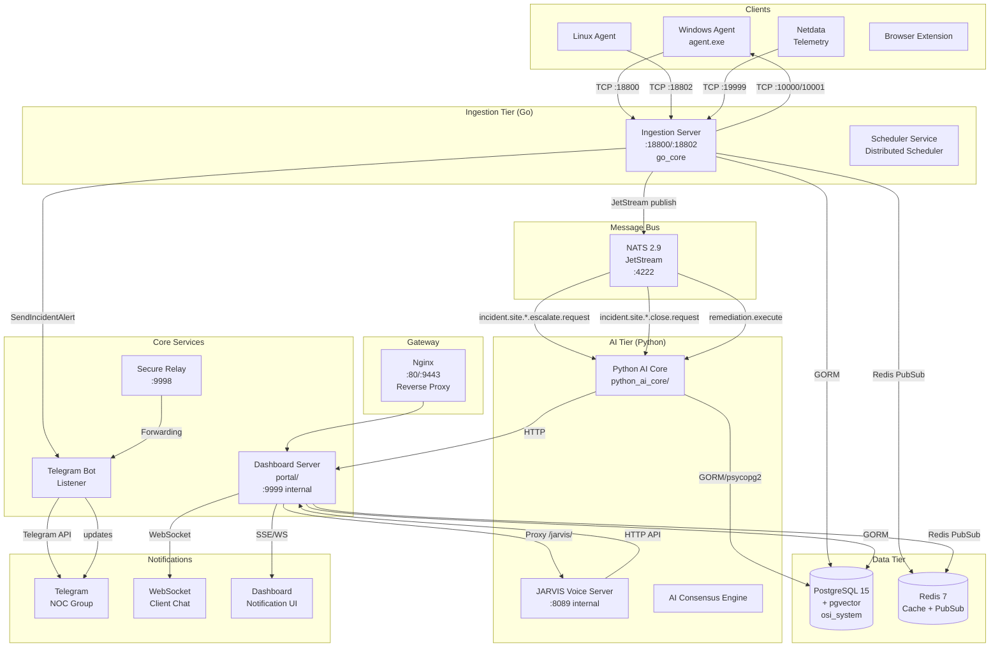
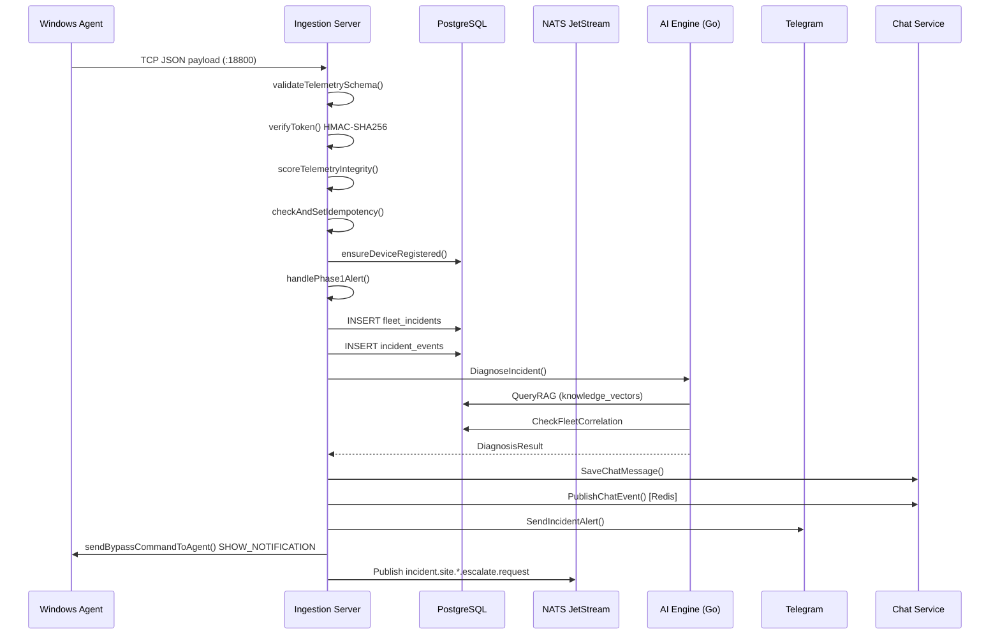
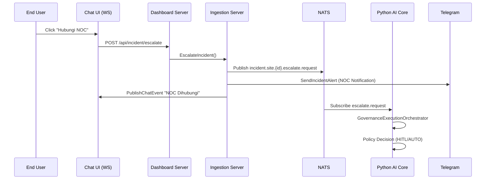
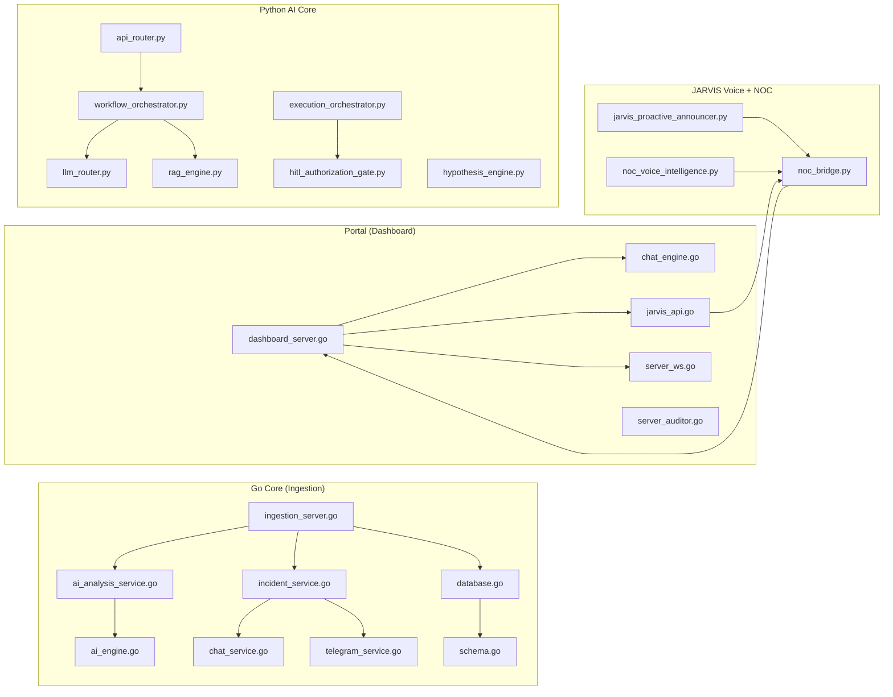
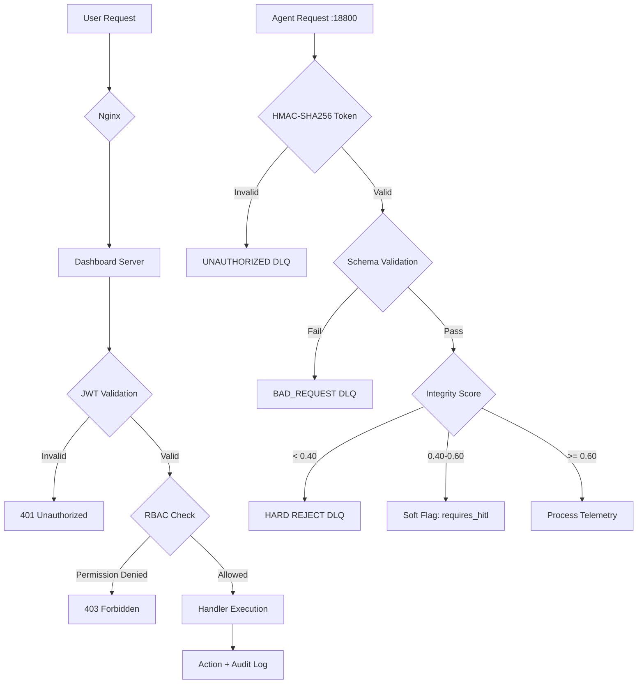

# SYSTEM ARCHITECTURE
## OSI NOC IT AI — Actual Architecture Map
**Evidence:** docker-compose.yml, ingestion_server.go, incident_service.go, noc_bridge.py, portal/  
**Status:** VERIFIED from source code analysis

---

## HIGH-LEVEL ARCHITECTURE

---

## INGESTION FLOW DETAIL

---

## INCIDENT ESCALATION FLOW

---

## MULTI-SERVICE COMPONENT MAP

---

## PORT MAP (VERIFIED)

| Port | Protocol | Service | Exposed To |
|------|----------|---------|-----------|
| 18800 | TCP (custom JSON) | Ingestion Server (primary telemetry) | Windows/Linux Agents |
| 18802 | TCP (custom JSON) | Ingestion Server (RCA/Remediation) | Agents |
| 19999 | TCP/HTTP | Netdata telemetry ingestion | Netdata agents |
| 4222 | TCP (NATS) | NATS JetStream | All internal services |
| 8222 | HTTP (NATS monitor) | NATS Monitoring | localhost only |
| 9999 | HTTP | Dashboard Server | Internal (via Nginx) |
| 8089 | HTTP | JARVIS Voice Server | Dashboard Server proxy |
| 9998 | HTTP | Secure Relay | Agents |
| 5432 | PostgreSQL | PostgreSQL (internal) | All services (internal) |
| 5433 | PostgreSQL | PostgreSQL (host-mapped) | localhost only |
| 6379 | Redis | Redis | All services (internal) |
| 80 | HTTP | Nginx | External |
| 9443 | HTTPS | Nginx | External |
| 10000/10001 | TCP | Windows Agent command receiver | Server → Agent |

---

## DATA FLOW MATRIX

| Source | Destination | Protocol | Data Type | Verified |
|--------|-------------|----------|-----------|----------|
| Windows Agent | Ingestion Server :18800 | TCP JSON | Telemetry, alerts, incidents | YES |
| Ingestion Server | PostgreSQL | GORM/SQL | All incident/telemetry data | YES |
| Ingestion Server | NATS | JetStream Publish | Incident events | YES |
| Ingestion Server | Redis | PubSub | Chat events | YES |
| Ingestion Server | Windows Agent :10000 | TCP JSON | SHOW_NOTIFICATION, SHOW_CHAT | YES |
| Ingestion Server | Telegram API | HTTPS | Incident alerts | YES |
| NATS | Python AI Core | JetStream Subscribe | Incident events | CONNECTED_BUT_NOT_VERIFIED |
| Python AI Core | PostgreSQL | psycopg2 | Read incidents, write analysis | VERIFIED |
| Python AI Core | Dashboard Server | HTTP | NOC Bridge calls | VERIFIED |
| Dashboard Server | JARVIS Voice | HTTP Proxy | Voice queries | VERIFIED |
| Dashboard Server | Redis | PubSub | Chat event subscribe | VERIFIED |
| Dashboard Server | Nginx | HTTP | All web traffic | VERIFIED |

---

## AUTHENTICATION ARCHITECTURE

